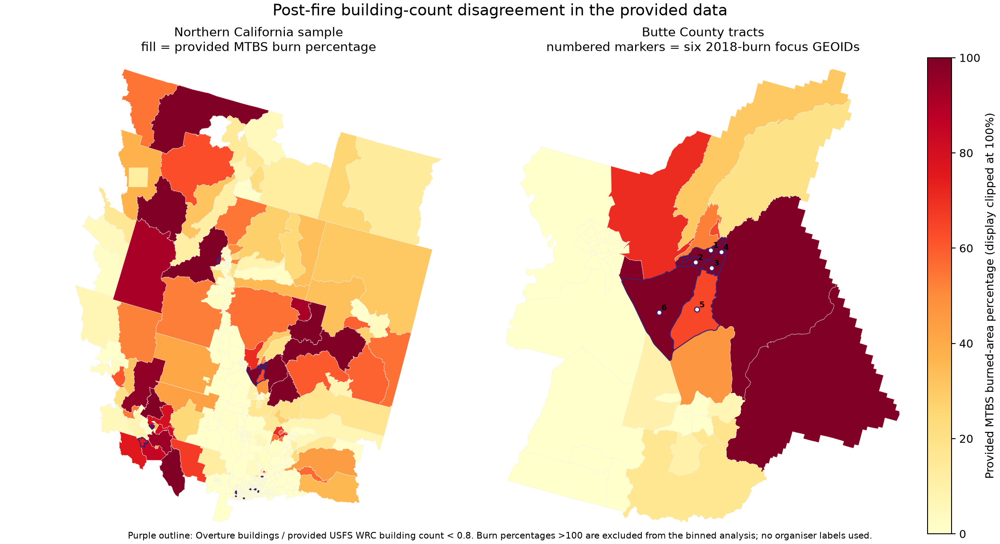

## Finding 1 — Rio Grande border metros: Google-sourced footprints mask a community-source gap

### Impact and novelty

These ten South Texas counties include 1.77 million residents and colonia-serving communities. Prioritise partner-led verification; dispatch outcomes and OSM completeness were not measured.

### Evidence and mechanism

Across 460 border tracts, mean OSM-touched share is 9.18%, versus 61.48% in 5,541 others (68.66% in 4,600 urban others); mean tract-level Microsoft-only share is 67.48%. “Other” accounts for 254,346/886,361 footprints (28.70%); 290 tracts (1,183,693 people) are under 5% OSM. Difference: −52.30 points (county-cluster 95% CI [−61.24, −36.99]). With urbanity, log-density, overall SVI, and CDC SVI `EP_HISP` controls: −0.446 (SE 0.070; n=5,958, 185 counties), descriptive, not causal.

Border “other” footprints (254,346) nearly match regional Google Open Buildings (254,872); non-border “other” (977,049) nearly matches USGS lidar (976,523), a ±526 reconciliation supporting—but not proving—Google spill-over. Webb/Starr/Maverick median provided Overture/USFS ratios are 1.56/1.75/1.71, not a Microsoft component or score proxy.

| Border county | Tracts | Population | Mean OSM share (95% tract CI) | Other-source share* | Median Overture / provided USFS count† |
|---|---:|---:|---:|---:|---:|
| Hidalgo | 212 | 870,781 | 6.10% (4.25–8.19%) | 20.42% | 1.04 |
| Cameron | 121 | 421,017 | 13.27% (9.86–16.95%) | 28.97% | 1.39 |
| Webb | 69 | 267,114 | 6.16% (4.77–7.73%) | 40.80% | 1.56 |
| Starr | 17 | 65,920 | 1.91% (1.12–2.91%) | 47.99% | 1.75 |
| Maverick | 13 | 57,887 | 33.03% (21.53–44.33%) | 61.25% | 1.71 |
| Val Verde | 14 | 47,586 | 17.29% (6.78–33.24%) | 13.85% | 1.08 |
| Zapata | 6 | 13,889 | 27.63% (17.23–37.78%) | 32.26% | 1.42 |
| Jim Hogg | 2 | 4,838 | 3.35% (3.28–3.43%) | 0.00% | 0.98 |
| Duval | 3 | 9,831 | 3.71% (0.50–5.34%) | 0.00% | 1.02 |
| Dimmit | 3 | 8,615 | 3.51% (1.34–7.12%) | 3.78% | 0.63 |

*Weighted; Google attribution is regional. †Provided-field tract medians, not the Microsoft target; small-county intervals are unstable.

Hidalgo `48215021906`, `48215023525`, and `48215024404` have zero OSM share and 1,727, 1,765, and 2,212 footprints; Cameron `48061012002` has 3,084 and 0.03% OSM. Heat averages 53.5 vs 7.3 WBGT>30°C days/year (218 vs 3,654 covered tracts). Prioritise local verification; dispatch effects are unmeasured.

Board 34744 (“Colonias: the coverage gap the scorecard cannot see”) withdrew reconstructed-gap claims and now concerns road dispatchability; 35071 (“The Texas Colonias Infrastructure Vacuum”) covers rural/tribal-SVI composition; 34972 (“Maps nobody has touched since 2011”) stale road edits; 35333 (“Phantom roads”) TxDOT-checked old unnamed roads. Ours quantifies Google building spill-over against the Microsoft comparator.

Report/input hashes: `reports/discovery-border-metros.json` (`27779986d787594abdadf741c983db13dedf25fb476cc4ff2ae096a1a4260244`); source report `reports/source-provenance.json` (`e80171d07d555e8e77e533b35b8ae4ca71aee481e64f618d8a6dc63df0512565`). SVI terms are in Appendix F. Rebuild: `uv run --with numpy==2.5.4 --with pyarrow==26.0.0 python scripts/discovery/border_metros.py --workspace "$COMPETITION_WORKSPACE" --out reports/discovery-border-metros.json`.

## Finding 2 — Rural Overture buildings are less often OSM-sourced

### Impact and novelty

Rural tracts may have fewer OSM-touched buildings across all four regions, supporting local attribute verification. This is a plausible audit risk—not measured service failure or a marginal rurality/SVI scorecard restatement.

### Evidence

Rural OSM-touched shares are 16.83–38.68 points lower across Maricopa, Northern California, Eastern Oklahoma, and South-Central Texas; all tract-bootstrap intervals exclude zero. SVI-quartile contrasts are smaller and less consistent (`reports/source-provenance.json#/statistics`, `#/uncertainty_and_limitations`).

### What this does and does not show

Source tags indicate provenance, not accuracy, completeness, or age; rurality is not causal and SVI may confound. The analysis uses provided Overture sources/geometry only, with no external data or candidate changes (`reports/source-provenance.json#/data_and_restrictions`).

### Reproducibility

Rebuild: `python scripts/discovery_source_provenance.py --workspace "$COMPETITION_WORKSPACE" --out reports/source-provenance.json --figure reports/source-provenance.png`.

## Finding 3 — Paradise/Magalia building-count discrepancy

### Impact and evidence

In six Paradise/Magalia-area Butte County tracts affected by the 2018 Camp Fire, the provided Wildfire Risk to Communities counts exceed Overture counts (Overture/reference ratios 0.620–0.747). This geographic and temporal discrepancy is observed; fire damage is not established as its cause. Treating the larger count as current could misdirect field verification, a plausible risk rather than an observed dispatch failure. The six tracts have provided MTBS last-burn year 2018; public CAL FIRE DINS points are used only as a mechanism check (catalogue and incident layer retrieved 2026-10-29; catalogue CC BY, version unspecified).

| GEOID | Overture / reference | Reference − Overture | DINS destroyed | DINS major | Relative error |
|---|---:|---:|---:|---:|---:|
| `06007001800` | 0.620 | 666.4 | 3,314 | 3 | 0.799 |
| `06007002100` | 0.643 | 588.3 | 2,337 | 4 | 0.748 |
| `06007002000` | 0.662 | 579.5 | 2,870 | 4 | 0.798 |
| `06007001900` | 0.677 | 390.2 | 1,887 | 3 | 0.793 |
| `06007002300` | 0.720 | 668.9 | 2,386 | 2 | 0.720 |
| `06007002200` | 0.747 | 766.1 | 2,472 | 6 | 0.690 |

Inputs, definitions, and values are in `reports/discovery-postfire.json#/focal_butte_2018_burn_geoids` and `reports/discovery-dins-mechanism.json#/focal_butte_tracts`. The tract-bootstrap difference is +9.55 points (95% CI [+0.55, +20.89]); the county-cluster interval [−1.65, +16.67] includes zero, so magnitude remains exploratory (`reports/discovery-postfire-county-bootstrap.json#/county_cluster_bootstrap/cluster_95_percentile_interval`). The map marks the six tracts:

**Negative mechanism check.** DINS does not support the proposed fire-damage/rebuilding mechanism: 0/6 tracts met the ≤0.30 relative-error rule (which required at least 4/6), and Spearman was 0.4626068 across 28 last-burn-2018 tracts, below 0.60. Among 591 NorCal tracts, 576 with positive Overture counts have no Camp Fire DINS record (1,139,778 buildings); missing inspection records cannot establish absence or rebuilding. MTBS percentages are cumulative (64.4–153.8%); the count-field vintage is unverified. Details are in `reports/discovery-dins-mechanism.json`; this Camp Fire check uses DINS only, while Finding 1's SVI control is documented in Appendix F.

Reproduction: `scripts/discovery_postfire_stale_reference.py`, `scripts/audit_discovery_postfire_county_bootstrap.py`, and `scripts/discovery_dins_mechanism.py`; input paths, filters and hashes are recorded in the reports and workspace manifest.

## Finding 4 — The tribal/non-tribal pooled comparison is region-confounded

### Impact and novelty

A pooled tribal/non-tribal contrast in Eastern Oklahoma and South-Central Texas can reflect different regional mixes, not a general tribal pattern. This is a composition caveat, not a disparity or causal finding.

### Evidence

Of 858 `tribal_any` tracts, 805 (93.82%) are in Eastern Oklahoma; 6,002 of 8,521 non-tribal tracts (70.44%) are in South-Central Texas (`reports/discovery-strata-confound.json#/stratum_composition`).

### What this does and does not show

These are composition counts, not equity or target-score evidence. `tribal_any` is an overlap indicator, not legal status; comparisons should be region-stratified (`reports/discovery-strata-confound.json#/regional_counts_and_prevalence`, `#/missing`).

### Reproducibility

Rebuild: `python scripts/discovery_strata_confound.py --workspace "$COMPETITION_WORKSPACE" --out reports/discovery-strata-confound.json`.
