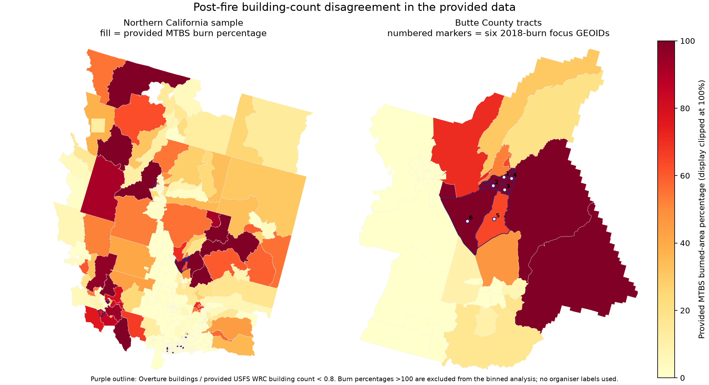
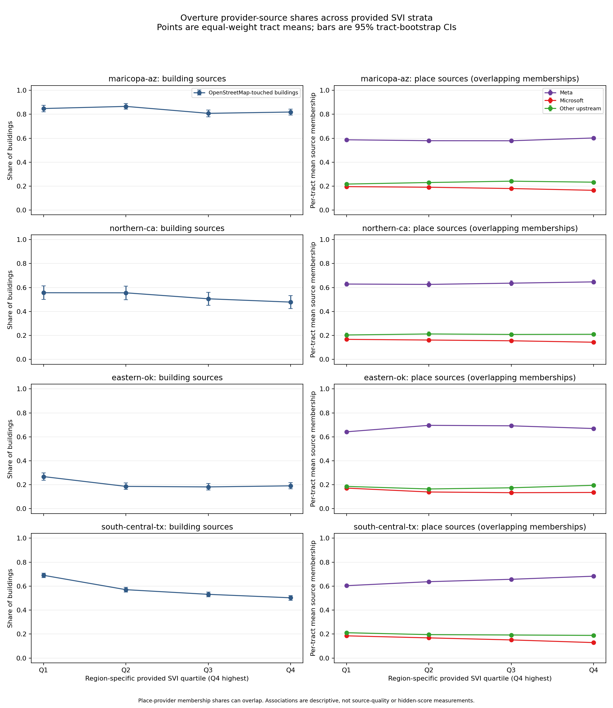

# Bias Bounty Mapping Equity Challenge — final methodology and discovery writeup

- Competition: `bias-bounty-mapping-equity-challenge` (Zindi)
- Lane: `comp-zindi-bias-bounty`
- Writeup revision: Family M evidence narrative refreshed; source/report lineage and hashes are recorded below.
- Zindi username or team name: **PENDING_OPERATOR_CONFIRMATION**
- Operator confirmation of that identity recorded: NO — pending operator
- Form submission status: **NOT SUBMITTED — staged for operator submission**
- Frozen final-two candidate IDs named for the form: not selected yet (recorded as null rather than invented)
- Official requirement: Your writeup should identify your Zindi username or team name and the leaderboard submission(s) associated with the methodology.
- Packaged for the organiser writeup form; form URL status: NOT AVAILABLE in the saved rules text

Scored scope: 9379 official tracts across four regions (2814 public / 6565 private expected), uploaded on the platform template of 9794 rows including 415 template-only rows.

Current model candidate presented in this writeup: `V2_model` at `reports/candidates/V2_model.csv` (SHA-256 `3193ee78a64004f007829f1f9c12d4aa8d4f7c15136771e8da9108fdcea06f12`), 9794 rows. Not uploaded: the frozen final-two protocol queues zero uploads and requires operator authorization.

Every quantitative statement in this writeup is covered by the claim-to-evidence audit summarised in the reproducibility appendix; nothing here is an accuracy claim beyond the platform scorecard values quoted verbatim from our submission log.

> The saved official page text in the workspace RULES.md preserves the sentence but not the hyperlink target, so the operator must supply the form URL; this build never guesses one.

## Prize consideration requested

We request consideration for both Best Bias Discovery ($1,000) and Best Documentation ($500).

### Best Bias Discovery entry — Best Bias Discovery ($1,000)

- Prize: Best Bias Discovery ($1,000).
- Official note: Entries for Best Bias Discovery are judged from the writeup by the organizing team against four criteria
- Judging criteria and weights (official text):
  - Impact: 30%.
  - Novelty: 25%.
  - Evidence: 25%.
  - Reproducibility: 20%.
- Tie-break: Ties are broken by earlier submission.

### Best Documentation entry — Best Documentation ($500)

- Prize: Best Documentation ($500).
- Official note: No separate leaderboard submission is required for Best Bias Discovery or Best Documentation.

## Leaderboard submissions associated with this methodology

| Platform submission id | Candidate | Artifact | Artifact SHA-256 | Public RMSE | Split | Score source | Uploaded (UTC) |
|---|---|---|---|---:|---|---|---|
| uRRw9KpB | C0 | `reports/candidates/C0_all_zero.csv` | `0edf8140123e2135489e5728fd71bce6f1e28a97f447ca411ba45fdbc02bc214` | 0.107246299 | n/a | zindi_api_status | n/a |
| BvyKrR6v | C1 | `reports/candidates/C1_region_constants.csv` | `dc2e368194b31408cb5c313fa8ce3f3fa59a1b5965bc2df8e4217bbc9e0c82e0` | 0.146449112 | n/a | zindi_api_status | n/a |
| rTARuUaG | C2 | `reports/candidates/C2_component_estimator_v0.csv` | `5728fbbaa2e062fbd14199190a260132c95b2b858da539d7a9580cb2abc62514` | 0.235358712 | n/a | zindi_api_status | n/a |
| TM83xxU6 | C3 | `reports/candidates/C3_denominator_x125.csv` | `e5ee50f5c2cca149550f3408638d2b77431f6ed62cf104dfe8c07d8c8416f9e4` | 0.349409867 | n/a | zindi_api_status | n/a |
| ySXi73rd | P4 | `reports/candidates/P4_c1_shrink_alpha.csv` | `8b329802d882ea4bdff2bfd8c465c160d6ffd9269cfbe28dce8be9e702b07d37` | 0.091440198 | n/a | zindi_api_status | n/a |

The scored methodology candidate in this writeup is `V2_model`, built from provided features only (commit `b45733aa31903c71ec4f3fb432c2bc9d519f3ff9`). Not uploaded: the frozen final-two protocol queues zero uploads and requires operator authorization. Its predicted public RMSE is 0.091357195976378675 on the stated model-side moments of the frozen artifact (mu_v, sd_v, E[v^2]) with the all-zero candidate C0 platform RMSE as the E[y^2] anchor, assumed target mean equal to the model's own mean and assumed centred correlation 0.3; no LB-derived model parameter basis, which is a model-side forecast, not a leaderboard observation.

The C0-P4 uploads above are historical calibration and probe records kept for auditability. They are excluded from the frozen final-two cohort and none of their leaderboard values, fitted constants or probe outcomes is used as evidence for the model or for any discovery claim.

## Best Bias Discovery entry

## Best Bias Discovery: post-fire building-count disagreement may look like under-mapping

**Status:** reproducible descriptive finding from challenge-provided inputs; not a claim about hidden organiser scores, the exact reference vintage, or measured emergency outcomes. The direction of the high-burn versus unburned disagreement is repeatable, but its quantitative size is exploratory once counties rather than tracts are resampled, as recorded below. No additional public dataset was used.

### Impact

In a set of six Butte County tracts in the Paradise/Magalia Camp Fire focus identified by the discovery brief, the provided Overture building count is 0.620–0.747 of the provided USFS Wildfire-Risk-to-Communities `usfs_BuildingCount_sum`. The provided MTBS attributes report a 2018 last-burn year for all six. The six tracts' provided `pop_total` sums to 6,977; this is a tract-population total, not a count of people confirmed displaced or affected.

If emergency or recovery planners interpret a building-count comparison as current map completeness when the reference still reflects pre-fire structures, destroyed structures can appear to be unmapped buildings. That mismatch could distort address inventories, dispatch geocoding, evacuation planning, or recovery-resource estimates. These are plausible risks, not observed dispatch failures or evidence about which source is operationally current. Fixed rural/wildfire strata alone cannot distinguish stale reference structures from genuine missing current map features.

### Novelty

This is a temporal source-provenance interaction: post-fire burn history is associated with disagreement between two provided building summaries. It is not simply a marginal rural, wildfire-risk, or SVI comparison. The result is consistent with the organizer's example class of post-disaster rebuilt areas and source behavior, but does not establish that the hidden score uses the USFS field or that it labels these tracts as coverage gaps.

### Evidence

The comparison is exactly `Overture overture_buildings / provided strata usfs_BuildingCount_sum`; ratio `<0.8` is a descriptive cutoff, not an organiser score. The table below comes from the authoritative 591-row NorCal sample. Camp Fire names are contextual labels supplied with the discovery lead; the provided columns themselves identify GEOIDs, county, burn percentage, and last-burn year, not fire incident names.

| Butte County GEOID | Overture / provided USFS count | Provided MTBS burned % | Last burn year | `pop_total` |
|---|---:|---:|---:|---:|
| `06007001800` | 0.620 | 100.0 | 2018 | 840 |
| `06007002100` | 0.643 | 100.1 | 2018 | 926 |
| `06007002000` | 0.662 | 100.0 | 2018 | 886 |
| `06007001900` | 0.677 | 100.3 | 2018 | 675 |
| `06007002300` | 0.720 | 64.4 | 2018 | 1,851 |
| `06007002200` | 0.747 | 153.8 | 2018 | 1,799 |

Two additional supplied examples are `06089010603` (ratio 0.691; MTBS last burn 2018) and `06033000704` (0.798; last burn 2017). The provided cumulative burned-area percentage can exceed 100 after repeated burns; values above 100 are kept in the named examples but excluded from the mutually exclusive 0–100% burn-class comparison.

| Provided NorCal burn class | Tracts | Ratio <0.8 | Share below 0.8 |
|---|---:|---:|---:|
| 0% (unburned) | 449 | 7 | 1.6% |
| >0–5% | 28 | 0 | 0.0% |
| >5–20% | 32 | 0 | 0.0% |
| >20–<50% | 32 | 0 | 0.0% |
| 50–100% | 36 | 4 | 11.1% |

Fourteen of 591 tracts have provided burned percentages above 100 and are excluded from these bins; none are missing a burn percentage. The high-burn minus unburned difference is **+9.55 percentage points**, and its 95% percentile interval is **[+0.55, +20.89] percentage points** under the published stratified 50,000-draw tract bootstrap but **[-1.65, +16.67] percentage points** when whole counties are resampled instead of tracts; under the criterion preregistered before any result was seen, the difference is therefore **exploratory** and is not established at 95% confidence. The two intervals answer different questions and are not interchangeable: the tract interval measures sensitivity to tract-level resampling of the binary ratio indicator at a fixed county composition, and because tracts inside one county share Overture provider mix, terrain and reference vintage it understates county-level dependence, so it is not the interval to quote when counties rather than tracts are the independent units; it also captures none of the spatial dependence, measurement error, source-vintage uncertainty, or hidden-target error. Butte County has 54 sample tracts, six below the ratio cutoff; their summed `pop_total` is 6,977.

That published interval resamples tracts independently. Tracts inside one county share Overture provider mix, terrain and reference vintage, so it understates county-level dependence, and the same statistic was rechecked with a county-cluster bootstrap that was preregistered before any result was seen (`reports/discovery-postfire-county-bootstrap.json`, `scripts/audit_discovery_postfire_county_bootstrap.py`): 50,000 seeded replicates resample all 23 counties of the analysis population with replacement, every tract record of a selected county is kept, and the difference is recomputed inside each replicate. The point estimate is unchanged, every replicate contained both focal groups (valid-replicate fraction 1.0), and 95.99% of valid replicates point the same way, but the 95% percentile interval widens from [+0.55, +20.89] to [-1.65, +16.67] percentage points, so its lower bound is no longer above zero. Under the preregistered criterion the quantitative difference is therefore **exploratory**: the direction is repeatable in almost every county resample, while this sample does not support it at 95% confidence once counties, rather than tracts, are treated as the independent units. The widening is not the artefact of one influential county: dropping any single county one at a time leaves the point difference between +5.56 and +10.71 percentage points, and the 36 high-burn tracts sit in 15 of the 23 counties. This remains a descriptive statement about disagreement between two provided layers; it does not establish cause, and it is not evidence that either layer is wrong, that any map is stale, or that any response or service differs.



**Source/vintage caution:** the compared count is the provided strata field `usfs_BuildingCount_sum`; its supplied edition metadata is recorded in `reports/discovery-postfire.json`. The observed ratios support the hypothesis that a 2018-vintage Microsoft-footprint derivative may be stale after wildfire, leaving a risk-building count above the Overture count. The tract-level analysis does not independently verify the supplied count's exact vintage. It does **not** claim that the organiser used a 2018 Microsoft release or this USFS field to construct its hidden target.

### Reproducibility

The script `scripts/discovery_postfire_stale_reference.py` reads the provided NorCal Overture feature cache, only selected fields from the provided strata table, GEOID values from the official sample, and GEOID/geometry columns from the challenge-provided ACS geometry object. It does not read placeholder scores, labels, removed reference layers, or DINS/external evidence. The script reproduces the ratio table, burn-class table, bootstrap CI, Butte population sum, and map; the deterministic report is `reports/discovery-postfire.json`, and the map is `reports/discovery-postfire-map.png`. The county-cluster recheck is a separate deterministic script with its own preregistered configuration, `scripts/audit_discovery_postfire_county_bootstrap.py`, whose report is `reports/discovery-postfire-county-bootstrap.json`:

```sh
COMPETITION_WORKSPACE="$COMPETITION_WORKSPACE" \
  /home/martin/hddProjects/langywrap/uv run --quiet \
  --with numpy==2.5.4 --with pyarrow==26.0.0 \
  python scripts/audit_discovery_postfire_county_bootstrap.py \
  --workspace "$COMPETITION_WORKSPACE" \
  --out reports/discovery-postfire-county-bootstrap.json
```

Two runs of that command produced byte-identical reports, and the audit fails closed if a county is missing from the resampling pool, if the resampled clusters are not whole counties, or if the writeup fails to state the robustness verdict; it re-runs the published tract-level design as a reference control and reproduces its frozen interval exactly, and it never re-tunes the ratio cutoff or drops a county. No scored candidate CSV was changed; their hashes are captured in the report.

From the competition repository with the authorized workspace and network access to the provided challenge geometry object:

```sh
MPLCONFIGDIR=/tmp/zindi-bias-bounty-mplconfig \
  /home/martin/hddProjects/langywrap/uv run \
  --with pyarrow --with numpy --with matplotlib --with shapely --with pyproj \
  python scripts/discovery_postfire_stale_reference.py \
  --workspace "$COMPETITION_WORKSPACE" \
  --out reports/discovery-postfire.json \
  --map reports/discovery-postfire-map.png
```

A repeated run produced byte-identical JSON and PNG in the recorded environment. No external public data was used, so no DINS manifest or external-source licence/retrieval record is applicable. All statements about emergency-planning consequences are hypothetical, and the pattern is descriptive rather than causal.

### Section 2 — Scorecard strata are strongly region-composition confounded

#### Impact

An all-region tribal-versus-non-tribal or rural-versus-urban comparison can be mistaken for a coverage disparity when its groups have very different regional composition. That can misdirect mapping audits or investment: an apparent tribal “priority” could largely track Eastern Oklahoma rather than represent tribal communities across regions, while the much larger non-tribal group mostly represents South-Central Texas. If regional road-taxonomy differences affect the road metric, that artifact could likewise divert route-mapping work from communities with actual access needs. These are plausible decision risks, not observed dispatch failures or evidence of a true coverage gap.

#### Novelty

The automated scorecard reports marginal tribal and rural comparisons but does not make region composition the comparison itself. The provided sample shows that `tribal_any` is nearly an Eastern Oklahoma indicator, while the non-tribal comparison is dominated by Texas. The official rules also warn that Overture/TIGER named-road length ratios vary from 0.71 to 1.59 across regions because primary/secondary conventions differ. Those facts make a pooled road-equity result vulnerable to both stratum-mix and taxonomy effects. They do not establish the size or direction of a hidden-score disparity.

#### Evidence

The script joins only official sample GEOIDs to the provided `tribal_any` and `pct_urban` strata. Composition cells below are `tract count (% of that row's stratum)`; the sample row is the 9,379-tract denominator. Rural is strictly `pct_urban < 0.5`, urban is `>=0.5`.

| Stratum | Total | Eastern OK | Maricopa AZ | Northern CA | South-Central TX |
|---|---:|---:|---:|---:|---:|
| All official sample tracts | 9,379 | 1,192 (12.71%) | 1,593 (16.98%) | 591 (6.30%) | 6,003 (64.00%) |
| `tribal_any = true` | 858 | 805 (93.82%) | 37 (4.31%) | 15 (1.75%) | 1 (0.12%) |
| `tribal_any = false` | 8,521 | 387 (4.54%) | 1,556 (18.26%) | 576 (6.76%) | 6,002 (70.44%) |
| Rural, `pct_urban < 0.5` | 1,712 | 411 (24.01%) | 163 (9.52%) | 147 (8.59%) | 991 (57.89%) |
| Urban, `pct_urban >= 0.5` | 7,641 | 780 (10.21%) | 1,419 (18.57%) | 444 (5.81%) | 4,998 (65.41%) |

Within-region tribal prevalence is 67.53% in Eastern Oklahoma, 2.32% in Maricopa, 2.54% in Northern California, and 0.017% in South-Central Texas. The official sample contains 858 `tribal_any` tracts, of which 805 (93.82%) are in Eastern Oklahoma; 6,002 of 8,521 non-tribal tracts (70.44%) are in South-Central Texas. Thus a pooled tribal contrast is also a comparison of sharply different region mixtures. The rural group is less concentrated but still 57.89% Texas; 26 official tracts have missing `pct_urban` and were excluded rather than imputed.

The earlier backlog measurement listed rural counts of 412/174/147/1,005 for Oklahoma/Arizona/California/Texas. Those counts equal the strict threshold counts above plus the corresponding missing `pct_urban` rows (1/11/0/14). A missing value is not `<0.5`, so this report does not silently treat it as rural. Input paths, hashes, exact selected columns, counts and the region-composition table are in `reports/discovery-strata-confound.json`.

The rules disclose a 0.71–1.59 cross-region Overture/TIGER named-road ratio range but do not map the endpoints to individual regions. The completed provided-Overture route audit (`reports/transport-route-ref-audit.json`) measures `sum(L_named)/sum(L_route)` as 1.929 in Maricopa, 1.504 in Northern California, 1.161 in Eastern Oklahoma, and 1.183 in South-Central Texas; the lane's broader 0.6–1.7 acceptance band is met in three regions, with Maricopa remaining high under the declared route-network filter. These are aggregate taxonomy diagnostics only: they use no TIGER observations, labels, LB feedback, or per-tract hidden scores and do not identify which regions correspond to the organizer's undisclosed ratio endpoints. The earlier statement that route ratios were unavailable is superseded by this audit; the Maricopa filter/coverage limitation remains documented there.

#### Reproducibility

`scripts/discovery_strata_confound.py` reads only `GEOID` from each official sample CSV and `GEOID`, `tribal_any`, and `pct_urban` from each provided strata Parquet. It excludes the seven Texas strata rows outside the official sample and does not use sample score-placeholder values, candidate scores, labels, external data, or removed road references. Reproduce with:

```sh
/home/martin/hddProjects/langywrap/uv run --with pyarrow==26.0.0 \
  python scripts/discovery_strata_confound.py \
  --workspace "$COMPETITION_WORKSPACE" \
  --out reports/discovery-strata-confound.json
```

The script asserts 9,379 unique official IDs and deterministic cohort accounting. A repeated run produced byte-identical JSON. This establishes composition confounding in the provided sample; it does not estimate hidden coverage scores or validate the scorecard's accuracy.

### Secondary exploratory lead — rural × SVI minority-domain screen in South-Central Texas

**Draft for operator review; not a claim about true organiser scores.** The competition has no training labels, and the reference layers used to calculate the hidden target are removed. Every score below is a C2/C3 provided-data proxy. The analysis identifies a subgroup for follow-up; it does not establish an observed real-world mapping disparity or causation.

### Proposed pattern outside the published scorecard grid

The official scorecard description lists five equity metrics across separate dimensions such as rural/urban, SVI, CVI, tribal status, and hazard exposure. It does not specify a joint cell for rural tracts in the upper quartile of the provided `svi_minority` domain field. This draft examines that intersection within the South-Central Texas sample, rather than restating either marginal rural/urban or overall-SVI comparisons.

The analytic group is defined using only provided strata fields: `pct_urban < 0.5` defines the rural screen; among rural sample tracts with nonmissing `svi_minority`, the top quartile is `svi_minority >= 0.6549`. The threshold is computed within this region's rural tracts; it is not a published competition cutpoint. Four of 991 rural tracts lacked `svi_minority` and were excluded. This field is used as supplied and is not a claim about individual residents or legal tribal status.

### Quantified proxy evidence

| Group | Tracts | Mean C2 predicted composite |
|---|---:|---:|
| Rural, `svi_minority >= 0.6549` | 248 | 0.06522 |
| Other rural tracts with the field | 739 | 0.03034 |
| Difference (upper-quartile minus comparison) | — | **+0.03488** |

A 50,000-resample tract bootstrap gives a 95% percentile interval of **[+0.01676, +0.05509]** for the C2 difference. Under the preregistered C3 sensitivity candidate (all expected-reference proxies scaled by 1.25), the group means are 0.08578 vs 0.03931, difference **+0.04647**, interval **[+0.02678, +0.06808]**. These intervals reflect resampling variability among tract-level predictions only, not error in the estimator or uncertainty about the hidden targets. Spatial correlation is not modeled.

The C2 component comparison uses only tracts where that component is defined:

| Component | Upper quartile (n; mean) | Other rural (n; mean) | Difference | Bootstrap 95% interval |
|---|---:|---:|---:|---:|
| Transport | 210/248; 0.03353 | 657/739; 0.01533 | +0.01820 | [-0.00192, +0.04114] |
| Buildings | 248/248; 0.02856 | 739/739; 0.00000 | +0.02856 | [+0.01187, +0.04828] |
| POI | 248/248; 0.11783 | 739/739; 0.07153 | +0.04630 | [+0.01961, +0.07450] |

In this proxy screen, the difference is concentrated in building and POI gaps; the transport interval includes zero. The result is a hypothesis about the model's provided-data screen, not evidence that the organiser's score is higher in these tracts.

The highest C2 predictions in the upper-quartile group include these named GEOIDs (all have provided `pct_urban = 0.0`):

| South-Central TX GEOID | `svi_minority` | C2 composite | C2 transport | C2 building | C2 POI |
|---|---:|---:|---:|---:|---:|
| `48253020102` | 0.8039 | 0.9701 | 0.0000 | 0.9691 | 0.9711 |
| `48001950402` | 0.7942 | 0.9599 | 1.0000 | 0.9239 | 0.9558 |
| `48169980000` | 0.9353 | 0.9396 | 0.0000 | 0.9775 | 0.9018 |
| `48001950401` | 0.8334 | 0.9392 | 1.0000 | 0.8658 | 0.9517 |
| `48185180400` | 0.7483 | 0.8739 | 0.0000 | 0.8261 | 0.9217 |

The exact inputs, estimates, flags, group definitions, bootstrap seeds, and all top-10 candidate tracts are in `reports/discovery-rural-svi-minority.json`.

### Why this may matter; what it does not show

The official challenge describes South-Central Texas as a heat/drought region along I-35/I-37. If the building/place deficits suggested by this screen are present in operational maps, incomplete addressable-building and place information could make dispatch geocoding, locating services, evacuation planning, or relief routing less reliable for affected rural tracts. The named GEOIDs let organizers or local reviewers inspect these places using authorized data. No emergency incident records, dispatch outcomes, or observed routing failures were available or analyzed, so these consequences remain plausible risks—not measured impacts.

The predictor does not use `svi_minority`, but it is still a heuristic based on Overture summaries and population/land/urbanity covariates. It has no label validation; reported score values must not be interpreted as organiser targets. The interval does not capture estimator or spatial uncertainty. The group is descriptive, and the cutoff should be checked with stakeholders before making a stronger narrative. No additional public data was used, and nothing from this discovery was added to the scored candidate CSVs.

### Reproduction

```sh
/home/martin/hddProjects/langywrap/uv run --with pyarrow --with numpy \
  python scripts/discovery_rural_svi_minority.py \
  --workspace "$COMPETITION_WORKSPACE" \
  --out reports/discovery-rural-svi-minority.json
```

The 50,000-draw bootstrap uses fixed seeds; a second run generated byte-identical JSON. See `docs/writeup/methodology.md` for data provenance, proxy formulas, and broader limitations. Before any prize-form submission, review the interpretation, context, and tract IDs; do not present the estimates as verified gaps.

### Section 3 — Overture source mix differs across tract strata

**Status: descriptive discovery lead, not a measured map-completeness or hidden-score finding.** The question was whether the share of buildings with an OpenStreetMap source and the share of places without a Meta source are lower in high-SVI, tribal-overlap, and rural tracts, and whether this pattern relates to the provided summer heat/drought fields.

#### Method and source definitions

The analysis covers all 9,379 authoritative sample GEOIDs in Maricopa, Northern California, Eastern Oklahoma, and South-Central Texas. For Overture buildings and places, the source scan projected only `sources` and `bbox`; bbox centers were assigned to the official sample tracts using only the provided ACS GEOID/geometry layer. No Overture geometry, placeholder score, target label, removed reference layer, or additional external data was read. The per-tract source shares were appended to the workspace feature cache as discovery-only columns; `estimate_one` and the scored candidate outputs do not use them.

A building is OSM-touched when any source dataset is `OpenStreetMap` (or `OSM`). Place memberships are any `meta`, any `Microsoft`, and any other upstream dataset; the generic Overture and Overture-signals entries are excluded from “other upstream.” `non-Meta place share` means one minus the share of places with any Meta source. Provider shares are per-place membership indicators and may overlap; the separate source-class fields in the report provide a disjoint partition. These are provenance annotations—not evidence of source quality, age, feature completeness, or a unique provider contribution.

Quartiles are calculated within each region. Reported means weight tracts equally; 95% intervals resample tracts within groups (2,000 replicates). Contrasts are independent tract-bootstrap differences, group 1 minus group 0. Spearman correlations use average ranks and pairwise complete observations; they are descriptive and have no p-values or covariate adjustment.

#### Findings

The top-quartile-minus-bottom-quartile (`Q4−Q1`) contrasts were negative for both source indicators in all four regions. However, some intervals include zero, and the magnitude varies considerably:

| Region | Building OSM share, Q4−Q1 (95% CI) | Non-Meta place share, Q4−Q1 (95% CI) |
|---|---:|---:|
| Eastern Oklahoma | −7.71 pp [−11.50, −3.75] | −2.73 pp [−4.43, −1.07] |
| Maricopa, Arizona | −2.92 pp [−6.41, +0.82] | −1.50 pp [−2.92, −0.03] |
| Northern California | −7.81 pp [−15.36, −0.13] | −1.82 pp [−4.24, +0.55] |
| South-Central Texas | −18.75 pp [−21.26, −16.04] | −7.91 pp [−8.66, −7.18] |

The within-region Spearman correlations with `svi_overall` were negative in every region: −0.215 to −0.108 for building OSM share and −0.273 to −0.038 for non-Meta place share. The rural-versus-urban contrast was more consistent: rural-minus-urban OSM share ranged from −16.83 to −38.68 pp, with all four bootstrap intervals below zero; rural-minus-urban non-Meta share ranged from −11.85 to −19.29 pp, also with all intervals below zero. This is an unadjusted contrast, not an effect of rurality independent of SVI or geography.

Tribal-overlap contrasts were also negative in the three regions with more than one `tribal_any` tract, but counts differ sharply (805 in Eastern Oklahoma, 37 in Maricopa, and 15 in Northern California). South-Central Texas had only one `tribal_any` tract, so its apparent contrast is not generalizable. The `tribal_any` field is the supplied overlap indicator; it is not a legal-status classification.

High-heat and high-drought source contrasts changed direction across regions. For example, the OSM share in the top heat quartile was higher in Maricopa and Eastern Oklahoma, but lower in Northern California and South-Central Texas. The top drought quartile was higher in Northern California and lower in South-Central Texas, with near-zero contrasts in the other two regions. These do not support a consistent hazard-specific source pattern.

The ten lowest-OSM-share tracts within each region's high-SVI quartile are listed in `reports/source-provenance.json`. Examples include `40109108803` (Eastern Oklahoma; 0.063% OSM-touched of 1,581 buildings; rural; `tribal_any=true`), `04003000700` (Maricopa; 2.25% of 2,755; urban), `06007003200` (Northern California; 0.062% of 3,252; urban), and `48201433505` (South-Central Texas; 0% of 189; urban). These are screening examples only; the source share does not establish that a tract is missing buildings or services.



#### Interpretation and limits

The strongest repeatable descriptive pattern is lower OSM-source and non-Meta place membership in rural than urban tracts. The SVI gradient is smaller and less certain in some regions; heat/drought results are heterogeneous. This motivates provenance-aware review of map-source representation by rurality and vulnerability, but it does **not** establish that Overture coverage is incomplete, that one provider is more accurate, or that any operational service is absent. Relative to the published scorecard this is not a restatement of a marginal rural-versus-urban or SVI cell: the scorecard publishes those marginals, whereas this finding concerns the provider composition *inside* the same rural cell, a dimension the scorecard does not publish. For mapping programmes in Eastern Oklahoma, Northern California, Maricopa and South-Central Texas, a systematically lower OpenStreetMap-sourced share in rural tracts is a reason to weight source provenance when choosing where to send field verification or quality-assurance effort; that is a plausible audit-prioritisation consequence, not evidence that any service is absent from those tracts. The bbox-center assignment can misclassify features near tract borders; tract means are not population-weighted; spatial dependence, multiple comparisons, and confounding are not modeled. No score candidate or submission was changed.

#### Reproduction

The deterministic JSON and figure are `reports/source-provenance.json` and `reports/source-provenance.png`. The default command reuses the extended feature cache when present; `--refresh-source` re-reads only the provided Overture `sources` and `bbox` columns to rebuild it.

```sh
MPLCONFIGDIR=/tmp/zindi-bias-bounty-mplconfig \
  /home/martin/hddProjects/langywrap/uv run \
  --with pyarrow==26.0.0 --with numpy==2.5.4 --with pyproj==3.8.0 \
  --with shapely==2.2.0 --with matplotlib==3.10.8 \
  python scripts/discovery_source_provenance.py \
  --workspace "$COMPETITION_WORKSPACE" \
  --out reports/source-provenance.json \
  --figure reports/source-provenance.png
```

A repeated cache-based run produced byte-identical JSON and PNG. The report records source-object URIs, object/selected-column byte sizes, local input/cache hashes, and per-region source counts. No external-source retrieval or licence record applies because no additional public data was used.

## Methodology (Best Documentation entry)

## Reproducible methodology for the Bias Bounty coverage-gap challenge

**Purpose and status.** This is a reproducible Best Documentation methodology and a record of exploratory Best Bias Discovery analyses. It describes provided-feature proxies and fixed, unvalidated model components; it does **not** reconstruct the organiser's hidden target. No training labels or per-tract organiser scores are available. No new candidate has been assembled from the v2 component audits, and the proposed building prior still needs operator approval before scored integration. This document makes no local or private accuracy claim.

### Rubric checklist and reading guide

**Coverage: 100% of the documentation items listed below.** Completion means the method, limitations, and reproduction path are documented; it is not a claim of model accuracy.

| Documentation rubric item | Status and location |
|---|---|
| Data sources, source footprints, URIs, byte sizes, hashes, exact scope | Complete below; source-level byte/row inventory and local SHA-256s are distinguished explicitly. |
| Component calculations and defined/undefined handling | Complete below; detailed POI categories, fixed facility priors, and route sensitivity follow. |
| Zero-population, water, no-Overture, missingness, and template edge cases | Complete in [`edge-cases.md`](edge-cases.md), backed by `reports/edge-cases.json`. |
| Alternative aggregation/weighting history | Complete in “Alternative components and aggregation choices.” |
| Historical leaderboard calibration, parameters, results, and inferred moments | Complete in the generated [`probe-log.md`](probe-log.md), including failed/cancelled probes and score IDs. |
| Accuracy claims | None absent a successful scored submission ID. Historical public RMSEs appear only in the ledger-derived probe log and do not validate v2 or a hidden/private score. |
| Reproduction, scope limits, caveats, final recommendations | Complete below and in the linked audit commands/reports. |

### Data sources, scope, and provenance

The official scoring domain is the union of four published per-region sample files: 9,379 GEOIDs, all retained as strings and joined exactly. The official sample columns are `GEOID,transport_gap,building_gap,poi_gap,coverage_gap_score`; analysis reads only the `GEOID` field. **Sample score placeholders are never used as labels or feature values.** The platform's 9,794-row template has 415 additional eastern-WA rows; those rows are formatting-only, contain no supplied feature inputs, and do not extend the official scored-region scope. See [`docs/competition.md`](../competition.md) and the official captured rules at `$COMPETITION_WORKSPACE/RULES.md`.

Challenge inputs are public Source Cooperative objects under:

```text
s3://us-west-2.opendata.source.coop/humane-intelligence/bias-bounty-mapping-equity-challenge/reference/{region}/{region}-sample-submission.csv
s3://us-west-2.opendata.source.coop/humane-intelligence/bias-bounty-mapping-equity-challenge/reference/{region}/{region}-census-acs-housing.parquet
s3://us-west-2.opendata.source.coop/humane-intelligence/bias-bounty-mapping-equity-challenge/reference/{region}/{region}-overture-{roads|buildings|pois}.parquet
s3://us-west-2.opendata.source.coop/humane-intelligence/bias-bounty-mapping-equity-challenge/strata/{region}/{region}-strata-tract-table.parquet
```

The exact supplied source object sizes and source row counts recorded during the audits are:

| Region | Official sample | ACS geometry parquet bytes / rows | Overture roads bytes / rows | Overture buildings bytes / rows | Overture POIs bytes / rows | Strata parquet bytes / rows |
|---|---:|---:|---:|---:|---:|---:|
| Maricopa AZ | 1,593 | 3,457,173 / 1,593 | 80,052,206 / 494,492 | 324,720,762 / 2,908,224 | 40,987,154 / 300,046 | 793,492 / 1,593 |
| Northern CA | 591 | 3,037,540 / 591 | 43,515,963 / 191,836 | 130,554,079 / 1,164,724 | 16,168,720 / 116,897 | 354,711 / 591 |
| Eastern OK | 1,192 | 3,650,879 / 1,192 | 82,239,229 / 520,550 | 298,882,068 / 2,551,694 | 28,848,614 / 207,369 | 638,464 / 1,192 |
| South-Central TX | 6,003 | 13,758,433 / 6,010 | 299,751,270 / 1,937,009 | 1,269,949,045 / 11,463,801 | 179,937,096 / 1,300,334 | 2,800,838 / 6,010 |

The source inventory documents bytes and row counts but does not publish SHA-256 for the remote Overture/ACS objects. The following checksums identify the exact official sample and local strata files used. Feature-cache hashes are checksums of the **derived aggregate cache**, not of the remote source objects.

| Region | Official sample CSV bytes; SHA-256 | Local strata parquet SHA-256 | Derived Overture tract-cache bytes; SHA-256 |
|---|---|---|---|
| Maricopa AZ | 44,664; `1640b801d56ab308e68c65583b88cfb9e1555b05a6d0b922eaba22ac09960a31` | `f19ec2f5afd400827b2420a81916bdec95b08772badd85fdb250149c334a5fcd` | 239,311; `e6e4064ea3827b8262cf2c3fe96beaeecd40592a7ce9bf0976a37cfbca1bbc22` |
| Northern CA | 16,608; `f38017b5284667b80b451685fd146388c108e1b30308301289c7a96ecfe60902` | `7fc19dce5ca76ee94eb2006d9bd51bed71d5bfbcdf3ef756605e0998df940243` | 100,099; `37ccc687c45ce2ce19e75d378c1e68bebf678f19c45cb4fe95582d250506a87c` |
| Eastern OK | 33,436; `56cb40fba4008d646bc63c62c91e211871459224b3de8b3a886ff813803fd0d4` | `e82862b9d9db436410ad47df466e133df94df6328f6a138d5bd871b491ba0d54` | 194,636; `e5a06316c316f61bf25b80b48e89c1e7f0b1461a0b8cec5831aae24e0cf83fa6` |
| South-Central TX | 168,144; `afa59c0eb30c40be25ce82098f144447591b79cb9692e669b2f2fe7b7b1ee58e` | `55589565024414f244ccbcadcc45a90860a3840ec9d8a4bdfa8a126c2128a354` | 921,462; `51e36d01eec7b2e5a4f9b4986a5aabd70acd7ad10084fef040bc05ad88842746` |

Audit reports additionally record row-group/projection information and component-specific input hashes: `reports/sample-contract-audit.json`, `reports/gap-estimator-audit.json`, `reports/transport-route-ref-audit.json`, `reports/poi-category-audit.json`, and the source-traceable reports linked below. The Texas ACS/strata objects each have 7 extra rows relative to the official sample; joins explicitly filter those rows out. ACS `housing_units` is not read for score calculations and is never used as a denominator floor. The official challenge data is CC-BY-SA 4.0; no extra public data was required. No credentials, paid API, or non-public source is used.

### Organiser scoring context and our calculations

The task provides no labels. The organiser's stated score is the mean of defined transport, building, and POI components; an unavailable reference makes its component undefined and omitted from the divisor. Organiser component definitions are provided for context only. Removed TIGER/Line, Microsoft building-footprint, USGS facility, and Census CBP reference layers—or equivalent copies—must not be used to recreate or approximate the hidden target. No such references enter these analyses or scored predictions.

The deterministic C2/v0 screen uses only provided Overture feature summaries and allowed provided covariates (`ALAND`, `pop_total`, `pop_urban`, `pct_urban`). Geometry from the supplied ACS housing tract files is used solely for spatial clipping/tract assignment; no ACS housing count is read. Road geometry is clipped to authoritative sample tract polygons and measured in EPSG:5070; building/POI bbox centers are assigned to tracts. Exact formulas and audit lineage are in `reports/gap-estimator-audit.json`.

| Component | C2/v0 expected reference proxy | Definedness and component calculation |
|---|---|---|
| Transport | `0.35 + 0.55*sqrt(ALAND_km2) + 0.0007*pop_total + 2*urban_fraction` (expected named-road km) | Defined when expectation ≥6 km. Gap=`clip(1−overture_named_road_km/expected,0,1)`. |
| Buildings | `max(0.5,0.30*pop_total + 4*sqrt(ALAND_km2) + 5*urban_fraction)` (expected structures) | Defined when observed Overture buildings >0 or expectation ≥1. Gap=`clip(1−observed/expected,0,1)`. ACS housing units are not a floor or denominator. |
| Fire / EMS / schools | Fire=`0.15+pop/30000+0.45*u`; EMS=`0.15+pop/40000+0.45*u`; schools=`0.20+pop/2500+0.20*u` | Each type defined when observed count >0 or expected count ≥0.5. Gap per defined type is clipped `1−observed/expected`; facility half averages only defined types. |
| Establishments half | `0.20 + pop/70 + 0.50*u` (v0 proxy) | Defined when all-place Overture count >0 or expected establishments ≥1. Gap=`clip(1−observed/expected,0,1)`. No CBP data is accessed. |
| POI | Mean of defined facility half and establishments half | Equal-weight defined halves; if only one is defined, use that half; if neither is defined, POI is undefined. |
| Tract composite | No new denominator | Equal mean of defined transport, building, and POI components; undefined terms are omitted. If none are defined, no composite is emitted. |

For missing urbanity, use finite `pct_urban`; otherwise use `pop_urban/pop_total` when population is positive; if both are unavailable at zero population, use the disclosed neutral 0.5 fallback. In the proxy expected-reference formulas, land area is floored at 0.01 km². Unknown-category POIs are apportioned using the in-sample selected-category share in the legacy v0 screen, not treated as category-specific zeroes. These heuristics are explicit assumptions, not learned parameters. A serialized zero attached to `defined=0` is only a storage placeholder and is excluded from all means.

### Alternative components and aggregation choices

The published component structure motivates equal weight across defined transport/building/POI terms and equal weight across the two defined POI halves. This is transparent and avoids asserting external importance weights, but does not establish that the organiser's hidden implementation uses the same values or that this is predictive-optimal. Other tempting choices—always dividing by three, filling undefined terms with zero, using housing units as a building denominator, importing CBP counts, or adding an arbitrary global scale—were rejected because they alter the stated defined-component rule, mix incompatible units, use prohibited references, or amount to unvalidated calibration.

Historical alternatives C1 (region constants), C3 (v0 denominators ×1.25), P4 (global scale of C1), P5 (region mean plus residual), and P6/region indicators are described with parameters, IDs, scores, inferred moments, assumptions, and cancellation status in [`probe-log.md`](probe-log.md). Those leaderboard-derived moments and coefficients are not accepted weighting choices for future models. P4's alpha remains only to reproduce its already-scored artifact. The route denominator alternatives state+US+Interstate, +FM/RM, and +explicit CR are a separate provided-feature sensitivity; the selected full route definition improves disclosed regional ratio-band coverage while accepting a documented trade-off in macro undefined-share error. No route alternative was chosen from leaderboard feedback.

### Historical leaderboard calibration (transparency only; not reusable)

The archived experiments include scored submissions and cancelled/dry-run probes. The generated [`probe-log.md`](probe-log.md) lists every ledger event, each probe's parameters, successful public RMSE only when paired with its recorded platform submission ID, artifact hashes, and the score-algebra moments or explicit “no moment” status. It documents the public-subset/all-official-row composition assumption and false initial score placeholders. In particular, P4's global scale is leaderboard-derived and reproduction-only; P5/P6/region probes were not successful scores. These statistics are historical disclosure and are forbidden as v2 priors, target moments, feature thresholds, or per-tract values. The operator's no-information-probe policy supersedes the historical plans; there is no new probe upload or candidate authorization here.

### Model-only v2 components and approval gates

V2 replaces v0's proxy rates with separately audited, fixed, challenge-feature-driven blocks. These audits report aggregate predictions and sensitivity; they do not form a combined candidate and do not demonstrate score accuracy.

- **Transport:** selected route-reference feature is `L_named/L_route` with `clip(1−L_named/L_route,0,1)`, defined only for `L_route>0`. `L_named` uses Overture named road classes; `L_route` is the sum of eligible named-route geometry from Overture route tags, each segment counted once. The chosen tags include state, U.S., Interstate, FM/RM, and explicit CR; details and kept/dropped network tables are below. No external road reference enters the feature. The aggregate ratio/undefined diagnostics are model-design checks only.
- **Facilities POI:** a pooled logistic prior estimates `P(reference type present)` from provided population density and urban fraction, then applies the explicit one-count-ahead expected-gap formula. The fixed qualitative coefficients, unclassified POI treatment, zero-presence definedness, and aggregate audit are in “Facility-miss POI v2.” No regional target moment or leaderboard feedback fitted these coefficients.
- **Buildings:** the experimental rule is a fixed building gap `0.01` only when `overture_buildings>0`, with zero-count rows undefined. It uses no ACS housing units, USFS, or CarbonPlan features. This remains a proposal requiring operator approval before scored integration; see `docs/decisions/building-component.md` and `reports/building-v2-audit.json`.
- **Building morphology sensitivity:** `config/building-morphology-preregistered.json` froze six equal-weight support features and beta sensitivities `0.01/0.02/0.05` before the Overture building-geometry scan. The separate `B_MORPH_V1` diagnostic uses only provided Overture geometry/attributes and allowed `ALAND`/population context. For defined rows, `gap=0.01+beta*(1-morphology_support)`; zero-count rows remain undefined. At primary beta `0.02`, the component mean is `0.02045` over 9,377 defined tracts; all 9,377 defined tracts differ from the `0.01` constant prior, while the two zero-building tracts retain the undefined numeric placeholder. Scores range from `0.01530` to `0.02809` among defined rows, finite and within `[0,0.1]`. This is a preregistered feature-sensitivity result, not a target accuracy test or an approved scored candidate; no reference footprint count, label, or leaderboard result was used. Full region summaries, attribute missingness, and all three beta distributions are in `reports/building-morphology-candidate.json`, with the tract-level diagnostic component table in `reports/candidates/building_morphology.csv`. Reproduce with `/home/martin/hddProjects/langywrap/uv run --with-requirements requirements.txt python scripts/build_building_morphology_candidate.py --workspace "$COMPETITION_WORKSPACE" --candidate-csv reports/candidates/building_morphology.csv --out reports/building-morphology-candidate.json`.
- **Building-source sensitivity:** `config/building-source-prior-preregistered.json` froze three qualitative exclusive-source-mixture profiles and beta values `0.01/0.02/0.05` before candidate measurement. `B_SOURCE_V1` uses only Overture-derived source-class shares plus `ALAND`/`pop_total`; support is `0.8 × weighted source-class share + 0.2 × bounded population-density context`, with `gap=0.01+beta*(1-support)` when Overture count is positive. The primary profile at beta `0.02` averages `0.01651` (defined rows q10/median/q90 `0.01329/0.01574/0.02068`, max `0.02603`); all 9,377 defined rows differ from the constant `0.01` baseline. Across fixed source profiles, the beta-0.02 means are `0.01930` (conservative), `0.01651` (primary), and `0.01574` (Microsoft-heavy). Shares describe provenance, not geometric identity or completeness; the screen is not an accuracy test or approved scored candidate. `reports/building-source-prior.json` includes per-region source shares, source-feature coverage and all profile/beta distributions; `reports/candidates/building_source_prior.csv` contains the tract-level diagnostic table. Reproduce with `/home/martin/hddProjects/langywrap/uv run --with-requirements requirements.txt python scripts/build_building_source_prior.py --workspace "$COMPETITION_WORKSPACE" --candidate reports/candidates/building_source_prior.csv --out reports/building-source-prior.json`.
- **Cross-theme support sensitivity:** `config/cross-theme-support-preregistered.json` froze `XTS_C2_V2` before final adjustment measurement. It adds at most `0.05 × (1−cross_theme_support)` to the frozen C2 prediction, where cross-theme support is half the mean plus half the minimum of three bounded Overture features: Microsoft building-source share, the route-network/named-road length share, and the share of places with confidence ≥0.5. The 9,379-row official-scope prior C2 hash is fixed in the manifest; 119 road and two building/place rows with missing feature support use neutral 0.5 fills with explicit flags. Primary output changed 9,377/9,379 rows; mean adjustment was `0.02874`, max `0.04617`, and global prediction variance changed `0.02413→0.02507`. Per-region prior→adjusted variances were OK `0.01503→0.01582`, AZ `0.02136→0.02190`, Northern CA `0.02106→0.02183`, and South-Central TX `0.02620→0.02711`. Raw support correlations are descriptive (building/road Pearson `0.305`, building/place `0.014`, road/place `−0.081`). Overture source membership, route tags, and confidence are internal indicators, not truth or completeness measures; no accuracy claim or v2 promotion follows. The exact features, missingness, distributions, four-region correlations, candidate ID/bounds, and CSV/manifest hashes are in `reports/cross-theme-support.json`; the analysis-only candidate is `reports/candidates/cross_theme_support.csv`.
- **Schema optional-attribute presence sensitivity:** `config/schema-presence-preregistered.json` freezes all 44 modeled optional fields from the supplied POI, building, and road top-level schemas, with every remaining top-level field explicitly excluded or assigned an identity/geometry role. POI `confidence` and all three `sources` fields are excluded so this is distinct from confidence weighting and source-mixture analysis. The builder reads only those selected attributes plus `bbox`; it assigns bbox centers to provided official tract polygons and reads only the frozen C2 model prediction as the baseline. Null, present-empty, explicit scalar `unknown`/`unspecified`, mixed unknown/known, and known values are separate states; unknown is not counted as missing, and schema-unavailable is distinct from row-null. Across 44 optional-field drop perturbations, the maximum candidate-score change is `0.00327` (≤`0.05`); with all selected fields unavailable the candidate falls back exactly to C2. On 9,379 official IDs, 9,377 have feature-support diagnostics; 4,687 rows (49.97%) adjust. The bounded candidate delta mean/median/p95/max is `0.00121/0/0.00499/0.01539`; C2's all-row mean changes from `0.16898` to `0.17019`. Mean field-level presence rates by theme (equal average of declared field rates among bbox-assigned records) span POIs `76.05–76.70%`, buildings `14.90–18.91%`, and roads `18.24–24.33%` across regions; the complete 44-field × theme × region status matrix and C2/candidate moments are in `reports/schema-presence-candidate.json`. All selected fields were present in the actual Parquet schemas, no exact `unknown`/`unspecified` scalar token occurred in the configured categorical fields, and empty nested/list fields were retained as separate states. Candidate scores are finite/in `[0,1]`; two complete builds were byte-identical. This is an internal metadata/support sensitivity, not evidence of geographic completeness or accuracy; bbox-center assignment is approximate. No labels, sample score placeholders, `sources`, confidence, removed references/equivalents, external feature data, or leaderboard feedback were used, and no upload or accuracy claim was made. Candidate CSV SHA-256 `b06c649eab390eee0f77465d01e7c728bdc126f92270b5570d618723037e3f18`; manifest SHA-256 `f4450ee825de7a41b3c5c5df1f5aefb1808904aaf028837ad414296667d1c700`. Reproduce with `uv run --with-requirements requirements.txt python scripts/build_schema_presence_candidate.py --workspace "$COMPETITION_WORKSPACE" --candidate reports/candidates/schema_presence_candidate.csv --manifest reports/candidates/schema_presence_candidate_manifest.json --out reports/schema-presence-candidate.json`.
- **Density-context sensitivity:** `config/density-context-preregistered.json` froze `DENSITY_C2_V1`, the 5 km/20 km centroid radii, log-density scales, and ≤0.05 positive adjustment before measuring the context features. It averages neighboring official-tract ACS population-density and Overture-building-density support, excluding each focal tract and indexing neighbors separately within each of the four regions. The inputs are the provided `ALAND`/`pop_total`/`ur_class`, Overture building counts, and only `GEOID,geometry` from the provided ACS tract polygon table; housing-unit and all other ACS columns are not read. Relative to frozen C2 on 9,379 official rows, 9,147 changed; mean candidate delta was `0.01035`, maximum `0.04720`, and prediction variance changed `0.02413→0.02338`. Delta means were Rural `0.01924` (n=1,712), Urban `0.00836` (n=7,641), and unclassified `0.00864` (n=26), descriptive only. Every region passed the leave-one-tract-out perturbation check (zero change), and the full 9,794-row template output uses the approved zero formatting fill for 415 featureless eastern-WA rows. The candidate is not an accuracy test or approved model integration; `reports/density-context-candidate.json` includes pre/post moments, region/urbanity coverage, missingness, neighbor summaries, bounds, and hashes; the analysis artifact is `reports/candidates/density_context_candidate.csv`.
- **Facility spatial-catchment sensitivity:** `config/facility-catchment-preregistered.json` froze the exact core fire/EMS/school categories, same-region pool, 1/5/10 km centroid radii, and a fixed 5% relative presence-prior uplift before spatial measurement. The builder reads only provided Overture POI `bbox,categories`, ACS `GEOID,geometry`, permitted strata fields, and the existing Overture summary columns needed to reproduce the pooled logistic baseline. Selected point counts assigned to official tracts reproduce the pinned audit's facility zero counts exactly: fire 5,892/9,379 (62.82%), EMS 7,282/9,379 (77.64%), schools 1,088/9,379 (11.60%). It applies `p_ref' = min(1, p_ref × (1 + 0.05 × (1−exp(−d_nearest/r))))` before the existing one-count-ahead expected-gap transform; no logistic coefficient is fitted. The official-scope facility-half mean changes from `0.12566` to `0.12751` at the 5 km primary radius (mean delta `0.00185`, max `0.00905`); 1 km mean/max delta is `0.00444/0.01373`, and 10 km is `0.00109/0.00726`. At 5 km, population-weighted centroid catchment shares across fire/EMS/schools are AZ `0.904/0.754/0.925`, Northern CA `0.836/0.692/0.890`, Eastern OK `0.806/0.691/0.860`, and South-Central TX `0.897/0.822/0.932`. The report includes per-type nearest-distance quantiles, region/urbanity deltas, zero-population cases (26 tracts), zero-ALAND cases (2), and edge/sparse catchments (220 tracts have none of the three facility types within 10 km). No USGS list/coordinates, external POI, removed reference, target, or leaderboard information was used. This is an analysis-only spatial sensitivity, not service-area evidence or an accuracy test. Reproduce with `uv run --with-requirements requirements.txt python scripts/build_facility_catchment_candidate.py --workspace "$COMPETITION_WORKSPACE" --candidate reports/candidates/facility_catchment_candidate.csv --manifest reports/candidates/facility_catchment_candidate_manifest.json --out reports/facility-catchment-candidate.json`; full radius/missingness/weighting diagnostics and SHA-256 values are in the report and manifest.
- **Candidate stability envelope:** `config/candidate-stability-envelope-preregistered.json` freezes six complete feature-derived score variants: C2 mechanistic baseline; cross-theme support; density context; a 5 km facility-catchment replacement over the v0 transport/building/CBP components; building morphology β=0.02; and primary source-prior β=0.02. The facility-catchment and two building variants are recomposed with the existing defined-component mean; cross-theme and density use their frozen full-score candidates. No target, public score, or fitted weights are used. The envelope is an analysis-only diagnostic; its equal-weight mean is not promoted or submitted, and the screen does not satisfy or bypass any scored-integration gate. It uses only the 9,379 official IDs; 415 template-only rows in C2/density files are ignored without parsing their candidate values. All six candidates align and are finite/in `[0,1]`. Spread median/p95/max is `0.11514/0.27016/0.51499`; `75.99%` of rows exceed `0.05`, so the preregistered `p95 ≤ 0.10` criterion correctly flags operator review. Region p95 spread is `0.20209` Eastern OK, `0.22034` Maricopa, `0.20836` Northern CA, and `0.33936` South-Central TX. Two no-defined-component edge rows in each building variant carry forward the existing C2 score; this deterministic fallback is disclosed. Candidate distributions, input hashes, feature-availability rates, and region × provided urbanity summaries are in `reports/candidate-stability-envelope.json`; the long-form member table and per-tract envelope CSV hashes are in its manifest. Two full builds were byte-identical. This is model-specification spread only: no local RMSE or empirical accuracy claim is available.
- **Establishments:** the explicit analysis-only sensitivity formula is `clip(1−overture_poi_all/(k_pop*pop_total),0,1)` for positive population, with `k_pop=0.024` used only as a task-specified sensitivity anchor. For zero population, positive places yield a defined clipped zero; zero places are undefined. The anchor has **no approval for scored use**, uses no CBP source, and is not a model coefficient; see `docs/decisions/establishments-half.md` and `reports/establishments-sensitivity.json`.
- **Combined score:** future assembly must average only model-defined terms and pass the exact-ID/schema/range/hash invariants. The component audits alone do not authorize v2 assembly or upload. There is no local labeled holdout; deterministic checks establish code/contract correctness only.

### Family M metadata and provenance estimator review

Family M is a descriptive screen of metadata, provider provenance, and name signals from the challenge-provided Overture layers, with permitted housing-unit context where specified. It is not a fitted coverage model or evidence about organiser scores. The committed summary records each output's defined-only distribution and coverage, the family pairwise rank correlations, VIF flags, and the matching per-tract Parquet SHA-256. Source metadata, tags, and names do not establish feature accuracy or service completeness.

| Idea | Provided-data quantity | Interpretation safeguard |
|---|---|---|
| `M1` | Road version summaries and the low-version share among tertiary roads | Version fields describe recorded metadata, not update recency or completeness. |
| `M2` | Wikidata-link shares across all places and among facility-like names | Link presence is not validation of a place or facility. |
| `M3` | Address-mismatch shares across places and among facilities | Address disagreement is a provenance signal, not proof of a wrong location. |
| `M4` | Chain-brand share and chain count per provided housing-unit field | Brand coverage and the density ratio are separate descriptive channels. |
| `M5` | Multi-property shares for buildings and roads | Both emitted channels are constant-zero on this study scope and are explicitly marked degenerate. |

The orthogonality screen shows that the all-place Wikidata-link share from `M2` and the chain-brand share from `M4` are nearly identical in rank order, so treat them as disclosed redundancy, not independent evidence. Facility variants from `M2` and `M3` also carry elevated VIF flags; they remain visible rather than being silently removed. This is not a promotion or a claim that any estimator recovers the hidden quantity.

Source and report lineage: implementation `src/bias60/ideas/m.py`, SHA-256 `05e69ae644a746f51e015b8780dfc58733766c8d3eae52f0b1fb9087cd6a71de` (source commit `4a921228beb4951f7d87cf59311ec15f28fc06ec`); Family M summary `reports/bias60-family-m-summary.json`, SHA-256 `ee9150150a184447189899dfdcec51254b6ae08d64c0c2c191633b1510d5d378` (report commit `a20f091905b1d08f10c9d8c38b90c2e0480c053e`). The summary binds Family-M-era harness and orthogonality snapshots by SHA-256 `c1c0f444b6d49dc5dc232f2055f8671d201a2728853ae141eaa09d2779768032` and `c85586f18d2d091082fa66142bc18152880f06d4515165d86713157c37c37417`. It reads the official GEOID partition, generated idea Parquets, and their harness/orthogonality reports.

### Edge cases, bias discovery, and interpretation

The full edge-case table and calculation policy are in [`edge-cases.md`](edge-cases.md), backed by `reports/edge-cases.json`. The audit finds 26 zero-population tracts, 2 zero-`ALAND` tracts, 43 tracts with a >50% water proxy, 132 with no selected named roads, 2,644 with no selected route-network km, 2 with no Overture buildings, 2 with no Overture places, and 26 missing `pct_urban` values. These are covariate/coverage characteristics, not hidden-score outcomes. The audit also reports fixed-prior v2 component distributions for zero-population, water-proxy, and other edge groups. The expected facility gap is `P(reference present) × conditional gap`, so low prior presence yields proportionally small expected gaps; missing `pct_urban` falls back to `pop_urban/pop_total`, or neutral 0.5 at zero population. These are component diagnostics, not an assembled candidate (the establishments half remains approval-gated). The water statistic is only `max(0,min(1,1−ALAND/geometry_area))` after projecting provided tract geometry to EPSG:5070; it is not an external water mask or a scoring correction.

Exploratory SVI/rural comparisons below are strata of C2/C3 **predictions** only. Their bootstrap intervals quantify tract-resampling variation in those proxies; they are not confidence intervals for the hidden organiser score. The analysis does not establish a causal mechanism, actual service access, or measured equity disparity. Avoid naming a high predicted gap as a confirmed underserved tract. For any future disparity assessment, compare within region or use common region weights: region composition confounds pooled comparisons, as documented in `reports/discovery-strata-confound.json`.

### Literature and feature-provenance context

The documentation-only prior-art review is [`docs/literature/completeness-prior-art.md`](../literature/completeness-prior-art.md); its coverage and URL-verification caveats are summarized in [`docs/literature/README.md`](../literature/README.md). It reviews road/building completeness, volunteered geographic information quality, provider/schema documentation, organizer-method context, and leaderboard-oracle ethics. Publication context motivates testing coverage mechanisms and careful uncertainty language; it does not contribute labels, per-tract rates, coefficients, or external numeric inputs to scored predictions. The selected Overture road/POI category definitions are documented in the audits, and all source-data restrictions remain as stated in the rules.

### Reproduction and recommendations

The broad source and method checks are available as deterministic repository scripts/reports. Recreate the new edge-case and probe-log artifacts from the competition repository:

```sh
uv run --with-requirements requirements.txt \
  python scripts/audit_edge_cases.py \
  --workspace "$COMPETITION_WORKSPACE" --out reports/edge-cases.json
uv run --with-requirements requirements.txt \
  python scripts/render_probe_log.py --out docs/writeup/probe-log.md
```

Then run the full unit suite with the pinned runtime (`uv run --with-requirements requirements.txt pytest -q`). Audit scripts for route variants, POI categories, facility misses, building v2, establishments sensitivity, and discovery are individually reproducible using commands in their linked reports/method sections. Never read a hidden target, removed reference, leaderboard page, or score placeholder to regenerate these documents.

**Recommendation:** retain the transparent equal-defined-component aggregation as a methodology description, not as an accuracy claim; use the selected Overture route definition only after the remaining model/approval gates are met; keep the building and establishments priors out of scored predictions until separately approved; and avoid water corrections or subgroup calibration without allowed evidence. Do not submit an information probe. Any future score evaluation must be a completed, documented model candidate and follow [`docs/submission-policy.md`](../submission-policy.md). The historic leaderboard log is disclosure, not authorization.

### Route-reference transport v2 (provided Overture only)

The opt-in route audit is `scripts/estimate_gaps.py --route-audit-only`. It reads only the provided Overture roads `class`, `routes`, and `geometry` columns, official sample GEOIDs, the provided ACS tract `GEOID`/`geometry` solely for clipping, and the existing v0 component flags for an any-undefined comparison. It reads no TIGER or other road reference data, labels, sample score placeholders, or leaderboard values. Named classes remain `motorway`, `trunk`, `primary`, and `secondary`; the v0 `overture_road_km` field is preserved. The v2 `L_named` is independently clipped in EPSG:5070 as `overture_named_road_km_5070`; the v2 `L_route` is the length of each segment once if it carries at least one accepted route network, also clipped in EPSG:5070. The score term is `clip(1 - L_named/L_route, 0, 1)`, defined only for `L_route > 0` (undefined rows serialize gap 0 with `defined=0`).

The route filter accepts interstate (`US:I*`), U.S. (`US:US*`), state-level (`US:<state>` plus explicit SR, loop, spur, beltway, future, alternate, and bypass variants), and county `US:<state>:CR*` networks. It rejects historic/business and scenic networks (`NHT`, `NFSR`/`NFRS`, scenic tokens), missing network values, and unsupported non-route systems. County-name namespaces such as `US:OK:ADAIR` are listed but not treated as numbered county routes without an explicit `:CR` class. A segment with multiple accepted route networks contributes once to `L_route`; per-family length columns can overlap. `overture_route_core_km` and `overture_route_plus_fm_rm_km` are cached separately so the declared Texas FM/RM sensitivity can be measured without re-reading/reclassifying target data. Since the existing repository already used aggregate cache schema v5 for source-mix features, route caches use aggregate schema v6 (base) or v7 (with source mix) and `route_schema_version=1`.

| Region | `sum(L_named)/sum(L_route)` | `L_named` / `L_route` km | `L_route=0` share | Route-v2 + v0 building/POI any-undefined share | Organizer disclosed any-undefined | v0 any-undefined |
|---|---:|---:|---:|---:|---:|---:|
| Maricopa AZ | 1.929 | 22,113.7 / 11,466.6 | 0.566 | 0.566 | 0.55 | 0.365 |
| Northern CA | 1.504 | 12,203.6 / 8,116.7 | 0.308 | 0.308 | 0.37 | 0.305 |
| Eastern OK | 1.161 | 27,944.0 / 24,071.9 | 0.240 | 0.240 | 0.21 | 0.407 |
| South-Central TX | 1.183 | 118,176.4 / 99,894.1 | 0.212 | 0.212 | 0.28 | 0.369 |

All four route-v2 transport + v0 building/POI any-undefined shares are within 0.10 of the disclosed region shares; they are a hybrid check, not a full v2 composite. Three of four length ratios meet the lane's broad 0.6–1.7 check; Maricopa is 1.929 and remains out of band even with all accepted state, U.S., Interstate, loop, and explicit county-route networks. The report identifies this as a denominator-coverage failure rather than adding prohibited scenic/business, missing-network, or unclassified county-name routes to force a ratio. In Northern California the observed route-entry counts reproduce `US:CA` 6,055, `US:CA:CR` 2,190, `US:US` 1,024, and `US:I` 861; the report lists all kept/dropped networks and counts for each region, per-tract `L_route` quantiles/bins, and v0 comparisons. The disclosed ratio band (0.71–1.59) and undefined shares are aggregate validation context only, not calibration targets. This is a route mechanism audit, not a validated accuracy result or assembled candidate.

### Connector-graph road topology sensitivity (analysis only)

`scripts/build_road_topology_candidate.py` preregisters `ROAD_TOPOLOGY_ROUTE_REF_V1` in `config/road-topology-preregistered.json`. It uses only the provided Overture road `class`, `connectors`, and `geometry` columns, official sample GEOIDs, provided ACS tract geometry for assignment, `pct_urban` strata, and the provided route-length cache. For each provided segment, connector points are interpolated from the connector's normalized `at` position; successive connector IDs form adjacency edges. The tract-local graph contains unique connector IDs assigned to that official tract and a simple undirected edge only when both endpoints of a successive connector pair map to the same tract. Cross-tract edges are counted but not included in the local graph; duplicate unordered edges are collapsed for degree/components. Isolated connector vertices are retained. Thus the reported graph is a tract-induced structural summary, not a routing/access network or independent truth source. The hypothesis is motivated by the road-completeness prior art in [`docs/literature/completeness-prior-art.md`](../literature/completeness-prior-art.md) and Overture's connector schema, but no global OSM rate or external road evidence is transferred into the candidate.

The measure-before route-reference component is recomputed as `clip(1 - overture_named_road_km_5070 / overture_route_km, 0, 1)`, defined only when route length is positive. It reconciles exactly to the frozen route-reference audit for each region's named/route length sums, route-zero count, and defined-only mean. Across 9,379 tracts the route-reference candidate is defined for 6,735 (71.81%), with a defined-only mean of `0.03166`; its numeric all-row mean (undefined rows stored as zero with a flag) is `0.02273`. The prior v0 transport component is defined for 5,914 (63.06%) and has all-row mean `0.09683`. The measure-before report also records legacy/named/route length distributions overall, by region, and by rural/urban `pct_urban` strata.

The frozen adjustment is `0.05 × (1 − largest_component_node_share)` and is added to the route-reference gap only on route-defined rows; route-undefined rows retain numeric zero and `defined=0`. This is a positive bounded context sensitivity, not a fit to a reference. Topology diagnostics were available for 9,377/9,379 tracts (99.98%). Across tracts, local components have median 6 and p95 34; mean dead-end-node share is 14.54%, mean degree is 2.24, median largest-component node share is 93.68%, and isolated single-node components average 3.40 per tract. The candidate adjustment mean/median/p95/max over all rows is `0.00513/0.00149/0.02409/0.04358`; 67.45% of rows change. Among route-defined rows, the route-reference gap mean changes from `0.03166` to `0.03880`. Regional candidate delta means range from `0.00321` (Maricopa) to `0.00571` (South-Central Texas); the full region × rural/urban degree, component, adjustment, definedness, and road-length tables are in `reports/road-topology-candidate.json`.

The edge audit processed 3,143,887 supplied road-segment rows and 8,491,546 connector occurrences. It skipped 1,087 segments with invalid/non-LineString geometry after valid connector parsing, observed 1,591 connector points outside the official tract polygons, and excluded 245,818 within-package adjacencies whose endpoints fell in different tracts. Two South-Central Texas tracts had no assigned connector nodes. These boundary/geometry cases are disclosed in the report and do not cause an unbounded fallback. The per-tract candidate is finite and in `[0,1]`; maximum actual change is `0.04358`, below the fixed `0.05` limit. Two complete builds were byte-identical. Candidate CSV SHA-256 is `612c2080c3d470fbcdc0cd752cd26847da05a35bf5d245c0b1599134cc82fda7`; manifest SHA-256 is `b269e4487905937d48418822aeb11a92e76f0371236d99e175e920d82852705f`.

No TIGER/MTFCC values, external road layers, labels, removed references/equivalents, sample score placeholders, or leaderboard information were used; no submission was made. Connector degrees/components can reflect cul-de-sacs, ramps, package edges, or schema/source artifacts and do not establish missing real-world roads or predictive accuracy. No local target RMSE is possible or claimed. Reproduce with:

```sh
uv run --with-requirements requirements.txt python scripts/build_road_topology_candidate.py \
  --workspace "$COMPETITION_WORKSPACE" \
  --candidate reports/candidates/road_topology_candidate.csv \
  --manifest reports/candidates/road_topology_candidate_manifest.json \
  --out reports/road-topology-candidate.json
```

#### Route denominator sensitivity and selected definition

`reports/transport-route-variants.json` compares the three cumulative alternatives using only the permitted workspace caches and disclosed aggregate context. The sequence is: (1) state + U.S. + Interstate; (2) add FM/RM; (3) add explicit CR county routes. Per-region length ratios, route-only undefined shares, and hybrid any-component-undefined shares are in the report.

| Variant | Regions inside disclosed 0.71–1.59 ratio band (of 4) | Regions inside lane 0.6–1.7 band | Macro mean absolute error of hybrid any-undefined share |
|---|---:|---:|---:|
| State + US + Interstate | 1 | 1 | 0.03356 |
| + FM/RM | 2 | 2 | 0.03646 |
| + CR | 3 | 3 | 0.04380 |

All three variants put all four hybrid any-undefined shares within 0.10 of the disclosed regional values. Selection is fixed from these diagnostics only: prioritize the number of regional ratios inside the disclosed band, then total distance outside it, and use macro any-share error as a tie-breaker. The selected denominator is state + US + Interstate + FM/RM + explicit CR: adding FM/RM moves Texas from 2.397 to 1.183, and adding CR moves Northern California from 1.768 to 1.504; three ratios are in band, while Maricopa remains 1.929. This choice trades some closeness on undefined-share error (the core-only variant has lower MAE) for substantially better disclosed ratio-band coverage; all variants satisfy the ±0.10 undefined-share check. The organizer supplied a cross-region range, not individual region ratios, so this is not a comparison to region-specific targets. No leaderboard values, labels, or reference layers were used, and no score probe or candidate was created.

Reproduce the sensitivity table without rescanning Overture source objects:

```sh
/home/martin/hddProjects/langywrap/uv run \
  --with pyarrow==26.0.0 --with numpy==2.5.4 \
  python scripts/audit_transport_route_variants.py \
  --workspace "$COMPETITION_WORKSPACE" \
  --out reports/transport-route-variants.json
```

Reproduce the underlying route audit from the repository (the command refreshes only route-derived columns in the authorized workspace feature cache and writes aggregate diagnostics):

```sh
/home/martin/hddProjects/langywrap/uv run \
  --with pyarrow==26.0.0 --with numpy==2.5.4 --with shapely==2.2.0 \
  --with pyproj==3.8.0 python scripts/estimate_gaps.py \
  --workspace "$COMPETITION_WORKSPACE" --route-audit-only \
  --route-audit-out reports/transport-route-ref-audit.json
```

### POI numerator audit and selected category definitions (2026-10-24)

The provided-data POI audit is reproducible with
`scripts/audit_poi_categories.py`; its full per-region frequency table for all
matching `categories.primary` and `categories.alternate` values is
`reports/poi-category-audit.json`. The report includes explicit zero rows for
categories absent from a region, primary/alternate counts, name-regex hits,
source-dataset mix, confidence quantiles, and tract-zero sensitivity. Counts
in the category-frequency table overlap: a single POI can have more than one
primary/alternate category, so those rows are not additive.

The audit read only official `GEOID` cells from the per-region sample files;
sample score placeholders were not used. For each provided Overture POI file,
Parquet projection included `categories`, `sources`, `confidence`, and `names`,
plus `bbox` solely to assign POI centers to tracts for the required zero-tract
sensitivity. It did **not** read the Overture `geometry` column, other POI
properties, external facility lists, or removed reference layers. Provided ACS
`GEOID` and tract `geometry` columns were used only as the tract spatial index;
POIs outside the 9,379 official sample IDs were excluded. Three Texas POI
centers did not intersect an official sample tract. The output records exact
selected-column compressed-byte counts, object sizes, and the ordered GEOID
sequence hashes; there was no full-object download. The selected POI column
chunks total 132,133,741 compressed bytes across the four regions.

The selected sets are now centralized in
`config/poi-category-definitions.json`; `scripts/estimate_gaps.py` reads that
same config, and a test asserts its FIRE/EMS/SCHOOL sets remain aligned. The
config requires the forthcoming estimator-v2 code to load `selected_sets`
from this file rather than duplicate categories or derive them from leaderboard
scores. A POI is counted once per component when its primary **or any alternate** category
matches one of these exact sets:

| Component | Selected categories | Decision |
|---|---|---|
| Fire | `fire_department`, `fire_protection_service` | Retain the two station categories used by the existing estimator. A broad `fire|rescue` match incorrectly adds firework retail, firearm training, fire/water restoration, fireplace service, firewood, and animal rescue. |
| EMS | `ambulance_and_ems_services` | Retain. Report `emergency_medicine` as a sensitivity only; exclude emergency rooms and roadside services because they are not EMS stations. |
| Schools | `school`, `elementary_school`, `middle_school`, `high_school`, `public_school`, `private_school`, `charter_school`, `religious_school`, `preschool`, `montessori_school` | Retain the canonical school set. Exclude dance, driving, music, cosmetology, flight, sports, vocational/specialty schools, administrative/retail education categories, and `day_care_preschool` absent evidence these match the organizer's school reference definition. |
| Hospitals | excluded | Follow the organizer's explicit exclusion; report category/name hits but never count hospitals in the facility numerator. |

Selected facility row counts below are unique POI rows per component (a POI may
match multiple categories); source counts count POI rows carrying each dataset
and therefore overlap across datasets.

| Region | Official tracts | Selected fire / EMS / school POI rows | `meta` / Microsoft / BrightQuery / Foursquare POI rows | Confidence q10 / q50 / q90 | Selected-facility confidence `<0.5` |
|---|---:|---:|---:|---:|---:|
| Maricopa AZ | 1,593 | 716 / 304 / 5,582 | 164,553 / 54,746 / 50,288 / 24,120 | 0.502 / 0.920 / 0.990 | 459/6,408 (7.16%) |
| Northern CA | 591 | 491 / 177 / 2,773 | 69,601 / 18,427 / 17,695 / 8,992 | 0.489 / 0.920 / 0.990 | 244/3,316 (7.36%) |
| Eastern OK | 1,192 | 866 / 471 / 4,836 | 132,819 / 31,847 / 23,601 / 13,985 | 0.503 / 0.920 / 0.987 | 416/5,881 (7.07%) |
| South-Central TX | 6,003 | 3,169 / 1,787 / 26,247 | 794,977 / 211,635 / 172,148 / 92,173 | 0.402 / 0.920 / 0.990 | 2,155/30,146 (7.15%) |

`Sources.dataset` is a multi-valued property: dataset row counts are not a
partition and are descriptive provenance, not weights or coverage labels. The
name-only regex audit also finds many POIs outside the selected exact category
sets (fire/EMS/school/hospital respectively: Maricopa 1,031/1,142/1,184/772;
Northern CA 344/322/573/355; Eastern OK 865/588/1,150/780; South-Central TX
4,019/4,541/4,873/3,733). Those are review flags only. A name regex is too
noisy to add a record to the score numerator; for example, it can match retail,
training, emergency-room, and administrative records.

| Region | Core zero tracts fire / EMS / school | All fire/rescue categories (fire zero) | Add `emergency_medicine` (EMS zero) | Add `day_care_preschool` (school zero) | All school/education categories (school zero) |
|---|---:|---:|---:|---:|---:|
| Maricopa AZ | 1,105/1,593 (69.37%) / 1,346/1,593 (84.49%) / 254/1,593 (15.94%) | 908/1,593 (57.00%, −12.37 pp) | 1,331/1,593 (83.55%, −0.94 pp) | 244/1,593 (15.32%, −0.63 pp) | 143/1,593 (8.98%, −6.97 pp) |
| Northern CA | 316/591 (53.47%) / 451/591 (76.31%) / 49/591 (8.29%) | 268/591 (45.35%, −8.12 pp) | 444/591 (75.13%, −1.18 pp) | 45/591 (7.61%, −0.68 pp) | 29/591 (4.91%, −3.38 pp) |
| Eastern OK | 646/1,192 (54.19%) / 864/1,192 (72.48%) / 130/1,192 (10.91%) | 495/1,192 (41.53%, −12.67 pp) | 853/1,192 (71.56%, −0.92 pp) | 121/1,192 (10.15%, −0.76 pp) | 67/1,192 (5.62%, −5.29 pp) |
| South-Central TX | 3,825/6,003 (63.72%) / 4,621/6,003 (76.98%) / 655/6,003 (10.91%) | 3,130/6,003 (52.14%, −11.58 pp) | 4,565/6,003 (76.05%, −0.93 pp) | 598/6,003 (9.96%, −0.95 pp) | 328/6,003 (5.46%, −5.45 pp) |

The sensitivity columns change only the named component and hold the other two
at the selected core sets. The broad regex options materially shrink zero
shares by admitting unrelated category types; they are not defensible facility
numerators. Adding `emergency_medicine` shifts the EMS zero share by only about
one percentage point, but it remains the wrong facility concept (clinical
emergency care rather than EMS stations). Adding `day_care_preschool` shifts
the school zero share by less than one point across regions; it remains
excluded pending reference-definition evidence. Thus the prior exact category
sets remain the chosen provided-data definitions. These are count/definition
audits, not evidence of target accuracy; no LB values or hidden targets were
used.

#### 50 m same-name facility dedup sensitivity

`scripts/audit_place_duplicates.py` compares raw selected facility rows with a 50 m same-name sensitivity in `reports/place-dedup.json`. It uses the configured fire/EMS/school category sets; normalizes only `names.primary` by Unicode NFC, casefold, and whitespace collapse; preserves punctuation; and leaves unnamed facilities untouched. Bbox centers are projected from EPSG:4326 to EPSG:5070. Within each normalized-name group, stable-order greedy clusters merge a row only when it lies within 50 m of a retained representative; cluster categories are unioned and assigned to that representative's tract. This avoids transitive chains whose endpoints are farther than 50 m. These are provided-data sensitivity results, not a target-accuracy test.

| Region | Facility rows, raw → deduplicated | Facility rows removed | Fire zero share, raw → deduplicated | EMS zero share, raw → deduplicated | School POI rows, raw → deduplicated |
|---|---:|---:|---:|---:|---:|
| Maricopa AZ | 6,408 → 6,405 | 3 (0.047%) | 69.37% → 69.37% | 84.49% → 84.49% | 5,582 → 5,579 |
| Northern CA | 3,316 → 3,315 | 1 (0.030%) | 53.47% → 53.47% | 76.31% → 76.31% | 2,773 → 2,772 |
| Eastern OK | 5,881 → 5,876 | 5 (0.085%) | 54.19% → 54.19% | 72.48% → 72.48% | 4,836 → 4,831 |
| South-Central TX | 30,146 → 30,119 | 27 (0.090%) | 63.72% → 63.72% | 76.98% → 76.98% | 26,247 → 26,220 |
| **All regions** | **45,751 → 45,715** | **36 (0.079%)** | **62.82% → 62.82%** | **77.64% → 77.64%** | **39,438 → 39,402** |

All 36 removed rows are school duplicates; no fire or EMS row is removed, so fire0/ems0 shares are unchanged. Keep raw Overture counts as the default: no evidence here shows dedup improves hidden-score accuracy, and leaderboard probing is prohibited. No candidate, estimator default, or submission was changed.

Reproduce the sensitivity from the competition repository:

```sh
OMP_NUM_THREADS=1 OPENBLAS_NUM_THREADS=1 MKL_NUM_THREADS=1 NUMEXPR_NUM_THREADS=1 \
  /home/martin/hddProjects/langywrap/uv run --with-requirements requirements.txt \
  python scripts/audit_place_duplicates.py \
  --workspace "$COMPETITION_WORKSPACE" --out reports/place-dedup.json
```

Reproduce the audit from the competition repository:

```sh
## Set COMPETITION_WORKSPACE to the authorized workspace before running.
  /home/martin/hddProjects/langywrap/uv run \
  --with pyarrow==26.0.0 --with numpy==2.5.4 --with shapely==2.2.0 \
  python scripts/audit_poi_categories.py \
  --workspace "$COMPETITION_WORKSPACE" \
  --out reports/poi-category-audit.json
```

### Facility-miss POI v2 (fixed prior; model-only audit)

The opt-in implementation is `scripts/estimate_gaps.py --poi-model facility-miss`; the default remains v0. It writes `reports/poi-facility-miss-audit.json` only and does not overwrite v0 estimates, manifests, or candidate files. The audited numerator uses the exact fire/EMS/school category sets in `config/poi-category-definitions.json`. It reads only official sample GEOIDs, provided `pop_total`, `ALAND`, `pop_urban`, `pct_urban`, the cached provided Overture type/all-place counts, and the existing v0 estimates needed for a hybrid-composite comparison. It reads no sample scores, labels, removed references, external datasets, or leaderboard values, and writes no per-GEOID output.

The model returns an expected type gap, not an imputed reference count. Its fully pooled, three-coefficient logistic prior is

```text
x_density = log1p((pop_total / max(ALAND / 1,000,000, 0.01)) / 100)
P(ref_t present) = sigmoid(intercept_t + beta_density_t * x_density
                            + beta_urban_t * urban_fraction)
conditional_gap_t = clip(1 - n_overture_t / (n_overture_t + 1), 0, 1)
E[gap_t] = P(ref_t present) * conditional_gap_t
```

Here `n_overture_t` is the selected exact-category count plus the provided summary's unclassified POI count multiplied by its in-sample selected-category share, matching the v0 treatment of unknown types rather than treating them as category zeroes. The `n_overture + 1` denominator is a one-count-ahead model assumption, not a measured reference denominator; it makes the conditional gap 1 at Overture zero and lets the positive-count gap decay as counts increase. When `P(ref_t present) == 0`, the reference is certainly absent and the component is undefined (numeric placeholder zero excluded from means). The facilities half is the mean of the defined expected type gaps. The POI component is the equal mean of the facilities and establishments halves when both are defined. For establishments this analysis uses the prior turn's task-specified `k_pop=0.024` anchor only as a sensitivity assumption; it is explicitly not authorized for scored use without a separately compliant prior and approval. Zero-population tracts with no Overture places have an undefined establishments half; positive observed places at zero population imply a zero, defined deficit under the clipped formula.

The coefficients are fixed qualitative domain priors, not supervised estimates and not fitted to organizer region/cell moments or leaderboard feedback. No region-specific intercept is fit: the model is pooled across regions because no allowed reference evidence supports regional calibration. Density and urbanity are expected to increase the probability that a reference facility exists; the school prior is higher than the fire/EMS priors because schools are a broader, more common facility type. The explicit coefficients are:

| Type | Intercept | Density slope | Urbanity slope |
|---|---:|---:|---:|
| Fire | −2.80 | 0.30 | 0.70 |
| EMS | −3.20 | 0.25 | 0.60 |
| Schools | −1.00 | 0.20 | 0.35 |

With the prior frozen, the audit reports the observed Overture zero counts by region × rural/urban cell alongside expected POI gaps. Rural is `pct_urban < 0.5`; urban is `>= 0.5`. Missing `pct_urban` falls back to `pop_urban/pop_total` for positive population, otherwise to a neutral 0.5, with each fallback counted. The per-region expected POI means are Maricopa 0.15788, Northern California 0.12576, Eastern Oklahoma 0.08459, and South-Central Texas 0.11873—all inside the backlog's 0.02–0.20 range. Across 9,379 official tracts, v0 POI mean is 0.25704 versus v2 0.12148; v2 `E[p²]` is 0.030688 and 15.84% of tracts have POI v2 > 0.25. The full per-region and per-cell table (`n`, `fire0`, `ems0`, `sch0`, POI mean, `E[p²]`, and >0.25 share) is in the JSON report. The hybrid composite (v0 transport/building, v2 POI) has mean 0.11301 and `E[p²]` 0.031126; this is not an assembled v2 candidate.

The report intentionally leaves region-mean-constrained predicted RMSE null. There are no labels, and the operator amendment prohibits fitting to region/cell target moments. All displayed cell means are diagnostics computed after fixing the prior; they do not feed back into its parameters. These estimates are unvalidated model outputs, not hidden-score or accuracy claims. The default v0 scoring path and the previously committed candidate artifacts remain unchanged. Reproduce with:

```sh
/home/martin/hddProjects/langywrap/uv run \
  --with pyarrow==26.0.0 --with numpy==2.5.4 --with shapely==2.2.0 \
  --with pyproj==3.8.0 python scripts/estimate_gaps.py \
  --workspace "$COMPETITION_WORKSPACE" \
  --poi-model facility-miss \
  --poi-audit-out reports/poi-facility-miss-audit.json
```

### POI confidence-weighted count sensitivity (fixed thresholds)

The frozen, analysis-only builder is `scripts/build_poi_confidence_candidate.py`; its thresholds, category sets, v2 formula, and source-use rules are preregistered in `config/poi-confidence-weighting-preregistered.json`. It reads the four official sample GEOID columns, the provided tract geometry for bbox-center assignment, `ALAND`/population/urbanity strata, and only Overture `bbox`, `categories`, `confidence`, and `sources` columns. Exact fire/EMS/school category sets come from `config/poi-category-definitions.json`. A matched POI contributes once per selected family. At threshold τ, its selected-family count contribution is `confidence` when valid confidence is at least τ, and zero otherwise; raw counts remain separately reported. The existing v2 region-share allocation for no-category POIs and the establishments half are held fixed to isolate the confidence sensitivity. Existing pooled v2 priors and `k_pop=0.024` are analysis-only; source dataset membership is reported as provenance and receives no weight. Hospitals remain excluded.

Before weighting, raw core counts are 5,242 fire, 2,739 EMS, and 39,438 school POI-family rows (overlap between families is possible). Zero-tract counts are 5,892, 7,282, and 1,088 respectively. V0 POI score mean is `0.25699` over all official rows (`0.25704` among its 9,377 defined rows); the raw-count v2 POI mean is `0.12148` over all 9,379. The re-created raw v2 candidate matches the frozen v2 audit's means, variances, and defined counts overall and in each region. Every selected core POI has valid confidence and a dataset source in this input; source identity is descriptive, not a truth or completeness assessment.

| Confidence threshold | Mean POI candidate | Variance | Std. dev. | Mean Δ vs. raw v2 | Mean fire / EMS / school count Δ vs. raw | Defined tracts |
|---:|---:|---:|---:|---:|---:|---:|
| 0.5 | 0.12410 | 0.015889 | 0.12605 | +0.00261 | −0.09289 / −0.05209 / −0.72571 | 9,379 / 9,379 |
| 0.7 | 0.12563 | 0.015886 | 0.12604 | +0.00415 | −0.12614 / −0.07082 / −1.01624 | 9,379 / 9,379 |
| 0.9 | 0.12789 | 0.015841 | 0.12586 | +0.00641 | −0.19037 / −0.10017 / −1.44350 | 9,379 / 9,379 |

The outputs are deterministic, finite and in `[0,1]`, with exact official ID/order coverage; two complete builds were byte-identical. Regional and `ur_class` weighted-count/output moments, deltas, source coverage, and the v0/v2 measure-before tables are in `reports/poi-confidence-candidate.json`; the per-tract CSV and hash manifest are under `reports/candidates/`. Candidate SHA-256 is `28558424db768222ec7639986970af7a37b74228ef8f4e3190e5e58b6e19071c`; manifest SHA-256 is `061932cb63ce52b53924f73279540f603d2395b0e543f632888b501ebb0cf777`. Reproduce using:

```sh
uv run --with-requirements requirements.txt python scripts/build_poi_confidence_candidate.py \
  --workspace "$COMPETITION_WORKSPACE" \
  --candidate reports/candidates/poi_confidence_weighted.csv \
  --manifest reports/candidates/poi_confidence_weighted_manifest.json \
  --out reports/poi-confidence-candidate.json
```

This is a fixed-threshold sensitivity, not an accuracy test: no labels or target RMSE exist, confidence is not validation, and no candidate was promoted or uploaded.

### Overture POI confidence by SVI and urbanity

The deterministic diagnostic in `scripts/discovery_confidence_by_stratum.py`
computes per-tract Overture confidence quantiles in the authorized workspace
cache `gap-estimator/features/poi-confidence-by-tract.parquet`; stratum results
and 95% confidence intervals are in `reports/confidence-by-stratum.json`.
Only official sample GEOIDs, provided `svi_overall`/`pct_urban`/`svi_covered`,
Overture `bbox`/`confidence`, and provided ACS tract geometry for spatial
assignment were read. Overture geometry, scores, removed reference layers, and
external data were not used. The metric is the place-weighted share with the
provided confidence value `<0.5`; it is not a count of stale pages or an
accuracy measure. No source attribution was read, so the Facebook/staleness
explanation remains untested.

Quartiles are region-specific over official scored tracts with finite
`svi_overall`; equal values at cut points stay together in the higher quartile.
`pct_urban <0.5` is rural and `>=0.5` urban; missing values are excluded from
the cross-tab but remain in the per-tract cache. Intervals resample tracts
within each region × urbanity × SVI-quartile cell (10,000 seeded replicates)
and recompute the pooled low/valid-place ratio. They reflect tract resampling
only, not spatial dependence; the Q4−Q1 contrasts below are unadjusted
exploratory comparisons.

| Region | All-place confidence q10 / q25 / median | All places `<0.5` | Urban Q4−Q1 share difference (95% CI) | Rural Q4−Q1 share difference (95% CI) |
|---|---:|---:|---:|---:|
| Maricopa AZ | 0.502 / 0.768 / 0.920 | 9.95% | −2.24 pp [−2.86, −1.64] | −4.02 pp [−7.80, −0.39] |
| Northern CA | 0.489 / 0.770 / 0.920 | 10.26% | −1.38 pp [−2.35, −0.46] | +0.53 pp [−1.78, +3.19] |
| Eastern OK | 0.503 / 0.770 / 0.920 | 9.91% | −0.80 pp [−1.44, −0.18] | −3.47 pp [−4.92, −2.06] |
| South-Central TX | 0.402 / 0.750 / 0.920 | 12.38% | −6.06 pp [−7.71, −4.56] | −3.60 pp [−4.56, −2.60] |

The observed pattern is opposite the initial hypothesis that higher-SVI tracts
would have a larger low-confidence share: Q4−Q1 is negative in seven of eight
region × urbanity cells, with the Northern California rural interval spanning
zero. The largest contrast is South-Central Texas urban (Q1 16.02%, Q4 9.96%,
difference −6.06 pp). This consistent inverse pattern is material enough to
record as a descriptive quality caveat, not as evidence that vulnerable
communities have better maps: confidence distributions may reflect POI mix,
urban form, or other unmeasured factors, and confidence does not validate
feature correctness. It neither validates hidden scores nor supports a causal
or source-vintage claim.

Reproduce from the competition repository with the authorized workspace:

```sh
/home/martin/hddProjects/langywrap/uv run \
  --with pyarrow==26.0.0 --with numpy==2.5.4 --with shapely==2.2.0 \
  python scripts/discovery_confidence_by_stratum.py \
  --workspace "$COMPETITION_WORKSPACE" \
  --out reports/confidence-by-stratum.json
```

### Discovery screen

Every figure in this section is a C2/C3 provided-data proxy statistic computed over model
predictions. It is not a claim about true organiser scores, it is not an observed real-world
disparity measurement, and it does not establish causation.

The reproducible script is `scripts/discovery_rural_svi_minority.py`. It constructs a
within-region intersection not specified in the official description of the automated scorecard:

1. Restrict to the authoritative South-Central TX sample.
2. Define the rural screen as provided `pct_urban < 0.5`.
3. Among rural tracts with nonmissing `svi_minority`, calculate the empirical 75th percentile (`0.6549`). The high-field group is `svi_minority >= 0.6549`; the comparison group is below it. Four rural rows lack that field and are excluded. This is a domain-field-by-rural intersection, not the provided overall `svi_overall` field and not an ethnic/legal classification.
4. Compare mean C2 predicted `coverage_gap_score` across those groups. Also report C2 component gaps conditional on each component being defined. As a model-specification check, repeat the composite comparison under preregistered C3 (all expected-reference proxies multiplied by 1.25).
5. Compute 95% percentile intervals from 50,000 bootstrap resamples of tracts independently within each group. Seeds are fixed and saved in the JSON report. These intervals quantify tract-resampling variability only; they do not account for spatial dependence, proxy-model error, or hidden-target error.

The screen found 248 high-field rural tracts and 739 other rural tracts. Mean C2 proxy scores were 0.06522 and 0.03034, a difference of +0.03488 (bootstrap 95% interval `[0.01676, 0.05509]`). Under C3, the difference was +0.04647 (interval `[0.02678, 0.06808]`). For C2, defined-only building-gap means differed by +0.02856 and defined-only POI-gap means by +0.04630; defined-only transport-gap means differed by +0.01820 with interval `[-0.00192, 0.04114]`. The component case counts and defined rates are in the audit JSON.

### Reproduction

From the competition repository, with the authorized workspace available:

```sh
/home/martin/hddProjects/langywrap/uv run --with pyarrow --with numpy \
  python scripts/discovery_rural_svi_minority.py \
  --workspace "$COMPETITION_WORKSPACE" \
  --out reports/discovery-rural-svi-minority.json
```

The script produces a deterministic JSON report with input hashes, definitions, group counts, point estimates, bootstrap intervals, and the highest-scoring named GEOIDs. A repeated run produced byte-identical JSON. It does not download data, access credentials, alter candidate CSVs, or upload anything.

### Limitations and interpretation

This analysis is exploratory. C2/C3 are unvalidated estimates, and the contest provides no reference labels with which to establish their accuracy. A bootstrap interval around predictions is not an interval for true coverage gaps. Tract-level independence is especially questionable in spatial data; the bootstrap may understate uncertainty. The group cut is a transparent analyst-defined threshold; test other cutpoints only as separately documented sensitivity checks, not leaderboard tuning. The analysis is descriptive, not causal. `svi_minority` is used as supplied and should not be reinterpreted as an individual-level demographic label. The writeup identifies a subgroup for follow-up, not a proven disparity in organiser scores or real-world service outcomes.

### Scorecard reflection

The row `bias-lb-snapshot-and-scorecard` snapshots where we stand and what the organiser's Bias
Scorecard says about our scored submissions. `scripts/snapshot_lb_and_scorecards.py` reads only the
shared orchestrator ledger plus one read-only GET of the authenticated submission status path, writes
the dated file `reports/leaderboard/2026-10-25T051219+0000.json` and one
`reports/scorecards/<submission_id>.json` per submission, and contains no upload path at all;
`reports/lb-scorecard-snapshot.json` is the machine record of the whole snapshot.

In that snapshot 1,441 participants had produced 390 ranked teams. Quoted to the six decimals the
snapshot stores, our best public RMSE was 0.091440 (P4, platform submission `ySXi73rd`) at rank 274:
0.007553 above the ranked median 0.083887, 0.024401 above the rank-50 line 0.067039, and 0.091011
above the rank-10 boundary 0.000429. We do not treat that boundary as a modelling target: six teams
record an exact zero and the best positive score on the board is 0.000092, so the snapshot reports the
median and rank-50 gaps beside it instead of implying that rank ten is reachable by modelling.

The scorecard is more informative than the single number. The all-zero anchor `uRRw9KpB`
(public 0.107246) returns all nine dimensions `undefined`, each with the organiser's reason
"Reference group has zero mean gap; ratio is undefined", so a degenerate prediction is legible in
this rubric on its own. The two region-constant-shaped submissions `BvyKrR6v` (public 0.146449)
and `ySXi73rd` carry identical scorecards - summer heat disparity ratio 1.141 (14.1% larger) and
tribal-versus-non-tribal 0.705 (29.5% smaller), with every other dimension "Similar" - while their
public RMSE differ (0.146449 against our best 0.091440): shrinking the whole prediction scale moved
the score and left the equity profile untouched. The component estimator `rTARuUaG` (public 0.235359) and its scaled
variant `TM83xxU6` (public 0.349410) are where the rubric bites: rural-versus-urban 0.248 (75.2%
smaller), tribal 0.556 (44.4% smaller) and wildfire 0.621 (37.9% smaller). Read honestly, our own
component predictions assign systematically smaller gaps to rural, tribal and high-wildfire tracts
than to their reference groups, and the organiser's rubric surfaces that even in submissions whose
composite RMSE is poor.

Per the operator amendment of `2026-10-24` this paragraph is reflection only. No feature, threshold,
weight or parameter in the model chain was changed on the strength of any number above, nothing was
uploaded to obtain them, and no scorecard value is an input to any candidate; the snapshot records
`scorecard_influenced_parameters: []` and `no_upload_performed: true`, and the audit behind it fails
closed if either ever changes. The rural/tribal/wildfire asymmetry is reported because the organisers
encourage reflecting on the scorecard, and because it is consistent with the descriptive findings in
`docs/writeup/bias-discovery.md`, which are evidence for follow-up investigation and not for any
score-driven adjustment.

## Edge cases and documented limitations

## Edge-case register for the coverage-gap methodology

This table makes the handling explicit for low-information and structurally unusual tracts. Counts are aggregate diagnostics over the 9,379 official sample GEOIDs, not scores, labels, or evidence of predictive accuracy. The 415 eastern-WA rows exist only in the larger platform template and are excluded from these statistics and from the official scored-domain definition.

### Observed edge cases

| Region | Official n | Population 0 | `ALAND` 0 | Water proxy >50% | No named roads | No route-network km | Overture buildings 0 | Overture places 0 | No named roads/buildings/places | Missing `pct_urban` |
|---|---:|---:|---:|---:|---:|---:|---:|---:|---:|---:|
| Maricopa AZ | 1,593 | 11 | 0 | 0 | 33 | 901 | 0 | 0 | 0 | 11 |
| Northern CA | 591 | 0 | 0 | 2 | 7 | 182 | 0 | 0 | 0 | 0 |
| Eastern OK | 1,192 | 1 | 0 | 1 | 28 | 286 | 0 | 0 | 0 | 1 |
| South-Central TX | 6,003 | 14 | 2 | 40 | 64 | 1,275 | 2 | 2 | 2 | 14 |
| **Total** | **9,379** | **26** | **2** | **43** | **132** | **2,644** | **2** | **2** | **2** | **26** |

Water is an approximation, not an independently observed water mask: for the provided ACS tract geometry, project WKB geometry from EPSG:4326 to EPSG:5070, then calculate `max(0, min(1, 1 - ALAND / projected_geometry_area))`. A tract is listed as water-proxy-dominated when that value exceeds 0.50. This can be affected by polygon/land-area measurement differences; it is not used to alter any gap estimate. The two zero-`ALAND` Texas tracts are separately disclosed; the clamped proxy reaches 1.0 in those rows. Maximum proxy shares by region were 0.1196, 0.7606, 0.6028, and 1.0 respectively. Geometry was used only for this score-free audit and spatial feature aggregation, not as an external target proxy.

### Model-only v2 predictions for edge groups

The audit now applies the fixed provided-feature v2 component functions to every official tract and summarizes their output by edge-case group. The facility-half expectation is `P(reference type present) × clip(1 − observed/(observed+1), 0, 1)` for fire/EMS/schools, using the frozen pooled priors and the existing unclassified-category shares. This expected-gap form gives smaller values when the prior probability of a reference facility is low, even when Overture has zero facilities. Urbanity uses finite `pct_urban`, otherwise `pop_urban/pop_total` for positive population, otherwise the neutral 0.5 prior; all 26 zero-population tracts have missing `pct_urban` and use 0.5. The density-area denominator floors `ALAND` at 0.01 km², so zero-area tracts remain finite.

The transport and building columns below are component-level v2 predictions only. The `partial mean` is a diagnostic mean of whichever v2 transport, building, and facility-half terms are defined; it deliberately excludes the establishments half, whose scored-use anchor remains unapproved. It is **not** an assembled candidate, full POI estimate, hidden-score prediction, or accuracy claim. Full distributions (n, mean, min, q10, median, q90, max, undefined and non-finite counts) by region and edge group are in `reports/edge-cases.json`; all reported non-finite counts are zero.

| Edge group | Region | n | Facility-half v2 mean [q10–q90] | Partial available-component mean |
|---|---|---:|---:|---:|
| Population 0 | Maricopa AZ | 11 | 0.1163 [0.0686–0.1454] | 0.0559 |
| Population 0 | Northern CA | 0 | — | — |
| Population 0 | Eastern OK | 1 | 0.0858 [0.0858–0.0858] | 0.0319 |
| Population 0 | South-Central TX | 14 | 0.1158 [0.0608–0.1454] | 0.0607 |
| Water proxy >50% | Maricopa AZ | 0 | — | — |
| Water proxy >50% | Northern CA | 2 | 0.1705 [0.1554–0.1857] | 0.0736 |
| Water proxy >50% | Eastern OK | 1 | 0.0737 [0.0737–0.0737] | 0.0279 |
| Water proxy >50% | South-Central TX | 40 | 0.1405 [0.0666–0.2405] | 0.1003 |
| `ALAND` 0 | South-Central TX | 2 | 0.1454 [0.1454–0.1454] | 0.1454 |

No water-specific correction is applied. Missing/undefined transport or building components are omitted from the partial diagnostic rather than replaced with zero. The audit asserts finite bounded results and serializes with `allow_nan=False`; it writes no per-GEOID predictions.

#### Handling policy

| Case | Method behavior | Explicit limitation / safeguard |
|---|---|---|
| No organizer reference for a component | Organizer score omits the undefined component; the composite averages only defined terms. | Never convert an undefined component to a meaningful zero. Serialized zeros are placeholders and are excluded by defined flags. If no top-level component is defined, no composite is emitted. |
| Zero population | Use the v0 expected-count floor/baseline and the stated urbanity fallback; facility-v2 uses `ALAND` floor `0.01 km²` in its density index. In the standalone establishments v2 rule, positive Overture places at zero population yield a clipped gap of 0 and remain defined; zero population plus zero places is undefined. | 26 official tracts have zero population. The establishments sensitivity audit found 24 with positive POIs and 2 with no POIs; this is a model convention, not evidence those tracts have no establishments. |
| Zero land area | v0 expected-reference calculations floor area at `0.01 km²`; the facility density calculation uses the same floor. | Two tracts have zero `ALAND`; do not divide by zero, infer a target, or label the tract as water-only based on this alone. |
| Water-dominated / geometry-area mismatch | Report the clamped land-area complement as a descriptive proxy; no water-specific correction is applied. | 43 tracts exceed 50% by this proxy. Geometry-area mismatch can cause error; there is no observed water label in this calculation. |
| No observed named roads | A zero Overture road count is retained. In v0 the transport proxy is still defined when expected route length reaches 6 km; route-v2 is undefined when its selected route denominator is zero. | There are 132 tracts with no v2 named-road length and 2,644 with no selected v2 route-network length. The named/route mismatch can yield a clipped zero deficit where numerator length exceeds the denominator; this is a known limitation (notably Maricopa's aggregate length ratio). |
| No Overture buildings | Keep the observed zero. The v0 building term can still be defined by its expected-count threshold; standalone building v2 is undefined at exactly zero Overture buildings. | Two such tracts occur, both in South-Central TX. ACS housing units are not a denominator or floor. |
| No Overture places / no POI facility category | Apply each version's documented definedness rule. In the fixed-prior facility model, a facility type with `P(reference present)=0` is undefined; otherwise it contributes its expected gap. Establishments is undefined when both population and total Overture places are zero. | Two South-Central TX tracts have zero places and also zero named roads/buildings; do not treat missing place data as proof of absent reference establishments. |
| Missing `pct_urban` | Use `pop_urban/pop_total` if population is positive; for zero population use a neutral urban fraction of 0.5. Record fallback provenance. | 26 rows have missing `pct_urban`; they are not silently assigned rural in the model. Earlier rural discovery comparisons instead excluded missing values. |
| Extra rows in supplied data | Join on text GEOID and restrict all scored analyses to official sample IDs. South-Central TX strata/ACS tables contain 7 rows beyond the 6,003 official IDs. | No placeholder score fields are used. The 415 eastern-WA template rows are formatting-only and are not scored-region evidence. |
| Leading zeros / mixed state coverage | Keep GEOIDs as strings. Maricopa's official set includes 1,592 Arizona tracts and New Mexico tract `35023970000` (verified present in the official sample). | Never infer membership from county text or numeric conversion. Validate exact ordered official sample coverage. |

### Reproduce the aggregate audit

From the competition repository, with the authorized workspace available:

```sh
uv run --with-requirements requirements.txt \
  python scripts/audit_edge_cases.py \
  --workspace "$COMPETITION_WORKSPACE" \
  --out reports/edge-cases.json
```

The audit reads only sample GEOID column 0 (not score-placeholder cells), the listed strata columns, aggregate provided-feature columns, and the provided ACS `GEOID`/`geometry` columns. It reads no labels, hidden organizer results, removed reference layers or equivalent copies, leaderboard information, or additional public data. It writes counts only, with no per-GEOID score/prediction output. The JSON records source URIs, object/cache bytes, and SHA-256 for the local sample, strata, and feature-cache files. SHA-256 of the remote Overture/ACS source objects is not published in the source inventory and is not claimed here.

## External source register (URL and access date)

No external dataset is cited or used in the scored predictions. The register below lists the published prior art consulted for methodology know-how, with the date it was accessed, and the organiser-hosted challenge files the workspace downloader retrieved. No URL is needed to reproduce the scored predictions: they read only files inside the organiser data package.

| URL | Reference | Accessed | Role |
|---|---|---|---|
| https://api.zindi.world/v1/competitions/bias-bounty-mapping-equity-challenge/files/SampleSubmission.csv | organiser-hosted challenge file used by the workspace downloader | 2026-10-23 | official challenge data endpoint provided by the organisers; not an external dataset |
| https://zindi.africa/competitions/bias-bounty-mapping-equity-challenge | official challenge page (quoted rules and membership note) | 2026-10-25 | official challenge page; quoted text only, no data added to scored predictions |
| https://zindi.africa/competitions/bias-bounty-mapping-equity-challenge/rules | official page fetched while searching for the writeup form link | 2026-10-25 | official challenge page; documentation lookup only, no data added to predictions |
| https://arxiv.org/abs/1502.04585 | Citation: Avrim Blum and Moritz Hardt, “The Ladder: A Reliable Leaderboard for Machine Learning Competitions,” arXiv:150 | 2026-10-24 | prior art and methodology know-how; not a dataset and never joined to scored predictions |
| https://arxiv.org/abs/1707.01825 | Citation: Jacob Whitehill, “Climbing the Kaggle Leaderboard by Exploiting the Log-Loss Oracle,” arXiv:1707.01825. arXiv | 2026-10-24 | prior art and methodology know-how; not a dataset and never joined to scored predictions |
| https://docs.overturemaps.org/schema/ | Citation/documentation: Schema overview, Transportation Segment, and Places Place. URL check: all three official pages r | 2026-10-24 | prior art and methodology know-how; not a dataset and never joined to scored predictions |
| https://docs.overturemaps.org/schema/reference/places/place/ | Citation/documentation: Schema overview, Transportation Segment, and Places Place. URL check: all three official pages r | 2026-10-24 | prior art and methodology know-how; not a dataset and never joined to scored predictions |
| https://docs.overturemaps.org/schema/reference/transportation/segment/ | Citation/documentation: Schema overview, Transportation Segment, and Places Place. URL check: all three official pages r | 2026-10-24 | prior art and methodology know-how; not a dataset and never joined to scored predictions |
| https://doi.org/10.1016/j.buildenv.2023.110295 | Citation: Biljecki et al. (2023), Building and Environment, article 110295, DOI 10.1016/j.buildenv.2023.110295; listed b | 2026-10-24 | prior art and methodology know-how; not a dataset and never joined to scored predictions |
| https://doi.org/10.1038/s41467-023-39698-6 | Citation: Benjamin Herfort et al., “A spatio-temporal analysis investigating completeness and inequalities of global urb | 2026-10-24 | prior art and methodology know-how; not a dataset and never joined to scored predictions |
| https://doi.org/10.1080/13658816.2016.1189556 | Citation: H. Senaratne et al. (2017), “A review of volunteered geographic information quality assessment methods,” Inter | 2026-10-24 | prior art and methodology know-how; not a dataset and never joined to scored predictions |
| https://doi.org/10.1080/13658816.2017.1395883 | Citation: Zhou (2018), International Journal of Geographical Information Science, density–completeness study, DOI 10.108 | 2026-10-24 | prior art and methodology know-how; not a dataset and never joined to scored predictions |
| https://doi.org/10.1111/tgis.12073 | Citation: Christoph Barron, Pascal Neis, and Alexander Zipf (2014), “A comprehensive framework for intrinsic OpenStreetM | 2026-10-24 | prior art and methodology know-how; not a dataset and never joined to scored predictions |
| https://doi.org/10.1371/journal.pone.0180698 | Citation: Christopher Barrington-Leigh and Adam Millard-Ball, “The world’s user-generated road map is more than 80% comp | 2026-10-24 | prior art and methodology know-how; not a dataset and never joined to scored predictions |
| https://doi.org/10.2737/RDS-2020-0016 | Citation/documentation: Scott et al. (2020), Wildfire Risk to Communities: Spatial datasets of landscape-wide wildfire r | 2026-10-24 | prior art and methodology know-how; not a dataset and never joined to scored predictions |
| https://doi.org/10.3390/ijgi12040143 | Citation: Ullah et al. (2023), ISPRS International Journal of Geo-Information 12(4), article 143, MapSwipe/completeness | 2026-10-24 | prior art and methodology know-how; not a dataset and never joined to scored predictions |
| https://doi.org/10.3390/ijgi2041066 | Citation: Robert Hecht, Christian Kunze, and Stefan Hahmann, “Measuring Completeness of Building Footprints in OpenStree | 2026-10-24 | prior art and methodology know-how; not a dataset and never joined to scored predictions |
| https://doi.org/10.3390/ijgi7080289 | Citation: Maria Antonia Brovelli and Giacomo Zamboni (2018), ISPRS International Journal of Geo-Information 7(8), articl | 2026-10-24 | prior art and methodology know-how; not a dataset and never joined to scored predictions |
| https://github.com/microsoft/USBuildingFootprints | Citation/documentation: microsoft/USBuildingFootprints README. URL check: resolved; GitHub README fetched (repository is | 2026-10-24 | prior art and methodology know-how; not a dataset and never joined to scored predictions |
| https://www.census.gov/library/reference/code-lists/mt-feature-class-codes.html | Citation/documentation: U.S. Census Bureau, MAF/TIGER Feature Class Code Definitions. URL check: official Census page re | 2026-10-24 | prior art and methodology know-how; not a dataset and never joined to scored predictions |
| https://www.census.gov/programs-surveys/cbp/technical-documentation/methodology.html | Citation/documentation: U.S. Census Bureau, County Business Patterns Methodology. URL check: official Census page resolv | 2026-10-24 | prior art and methodology know-how; not a dataset and never joined to scored predictions |

Provided-data-only check for the scored predictions (`reports/v2-input-provenance.json`): field-lineage fraction 1.0, 0 prohibited source dependencies, 0 unclassified inputs, external data added to scored predictions: False.

## Reproducibility appendix

A machine-checked claim-to-evidence audit backs every number in this writeup.

- `claims_total`: 88
- `claims_fully_traceable`: 88
- `fraction_quantitative_claims_traceable`: 1.0
- `numeric_tokens_total`: 1036
- `numeric_tokens_covered`: 1036
- `fraction_numeric_tokens_covered`: 1.0
- `distinct_verify_commands`: 88
- `distinct_reproduce_commands`: 17
- `derived_aggregates_verified`: 31
- `claims_asserting_accuracy`: 2
- `claims_with_prohibited_data_language`: 0

Commands (all recorded exit code 0):

```bash
COMPETITION_WORKSPACE="$COMPETITION_WORKSPACE" /home/martin/hddProjects/langywrap/uv run --quiet --with reportlab==4.4.10 python scripts/build_final_writeup.py
/home/martin/hddProjects/langywrap/uv run --quiet python scripts/verify_writeup_submission.py
/home/martin/hddProjects/langywrap/uv run --quiet --with numpy==2.5.4 --with pyarrow==26.0.0 --with pyproj==3.8.0 --with shapely==2.2.0 --with pytest python -m pytest -q
COMPETITION_WORKSPACE="$COMPETITION_WORKSPACE" /home/martin/hddProjects/langywrap/uv run --quiet python scripts/audit_writeup_claim_evidence.py
```

Deterministic audit artifacts: `reports/writeup-claim-evidence-audit.json`, `reports/writeup-claim-inventory.json`, `reports/writeup-claim-evidence-execution.json`.

## Data provenance and prohibited-source statement

- Scored predictions are built only from the organiser-provided Overture roads, buildings and POI extracts, the provided census/ACS table, the provided strata table and the platform submission template, plus fixed documented priors.
- The organisers removed the reference layers (TIGER, MS Buildings, USGS, CBP). None of those layers, nor an equivalent copy, is used to build the scored predictions or to support any claim.
- No sample score placeholder, no label, and no leaderboard-probe outcome is used as model evidence. The retired leaderboard-fitted constants and probe values of the retired probe set are listed in `reports/probe-retirement-2026-10-24.json` and appear nowhere in the model chain, in this writeup, or in any claim evidence, by name or by value.
- Equity and hazard strata columns are used only for the descriptive discovery screen, never as model inputs; the descriptive reports state that they are not accuracy measurements.
- All code and tooling used is open source, as the rules require.

### Quoted official page text

Source: https://zindi.africa/competitions/bias-bounty-mapping-equity-challenge (documented 2026-10-25). official challenge page; quoted text only, no data added to scored predictions.

> One membership note: the Maricopa package is 1,592 Arizona tracts plus one New Mexico tract, 35023970000 (Hidalgo County, Tract 9700), which the region boundary meets at the state line.
> Participants must not use reference layers, or equivalent copies obtained elsewhere, to recreate or approximate the organiser-computed targets.

- Used for: cross-state scored tract disclosure in the edge-case section; independently verified present in the official Maricopa sample.
- Used for: prohibited-source statement.

### Organiser writeup form URL status

The saved rules text preserves the sentence 'To be considered, submit your methodology writeup through this form and clearly indicate whether you wish to be considered for Best Bias Discovery, Best Documentation, or both.' but not the hyperlink target. An attempt on 2026-10-25 fetched https://zindi.africa/competitions/bias-bounty-mapping-equity-challenge, https://zindi.africa/competitions/bias-bounty-mapping-equity-challenge/rules and the result was not recoverable programmatically: the page is client-rendered and the fetched preview ends before the writeup/prize section that carries the hyperlink target, so the form URL must come from the operator. The URL is therefore supplied by the operator at submission time rather than guessed here.
