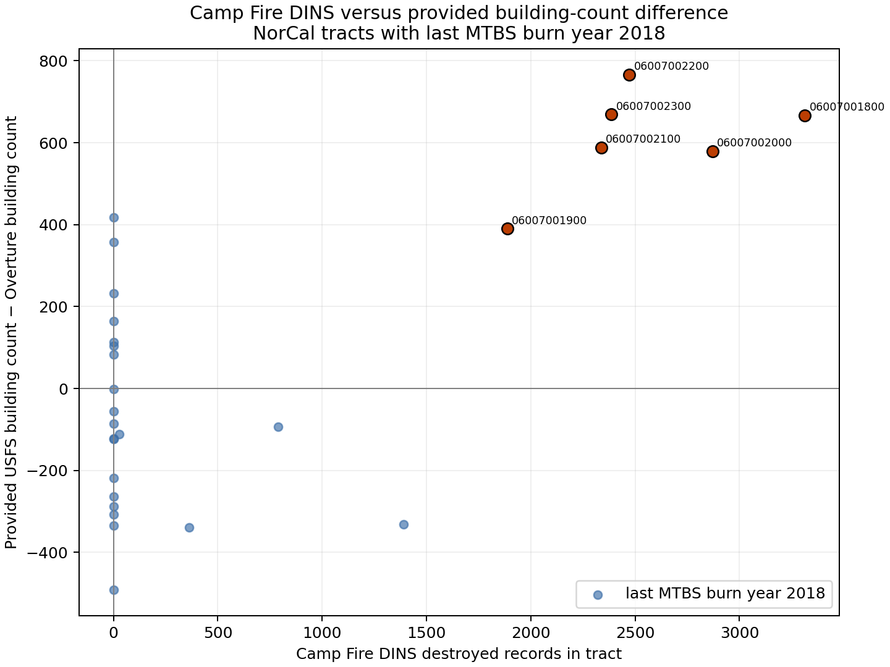

# Camp Fire DINS check of the post-fire stale-reference mechanism

**Result: NEGATIVE — The registered mechanism rule did not pass; the DINS counts do not meet both focal error and all-2018 cohort Spearman thresholds.**

This is a Best Bias Discovery-only external-data check. It does not read or change any scored candidate. The data-source catalogue labels the dataset Creative Commons Attribution (CC BY; version not stated); downloaded 2026-10-29T07:12:08Z from [https://data.ca.gov/dataset/cal-fire-damage-inspection-dins-data](https://data.ca.gov/dataset/cal-fire-damage-inspection-dins-data) via the filtered [CAL FIRE ArcGIS layer](https://services1.arcgis.com/jUJYIo9tSA7EHvfZ/arcgis/rest/services/POSTFIRE_MASTER_DATA_SHARE/FeatureServer/0). Retrieval, filter, selected fields, licence metadata, limitations and raw-file SHA-256 are recorded in `/home/martin/hddProjects/competitionsall-workspace/zindi-bias-bounty/external-discovery-2026-10-29/MANIFEST.json` (7e574a0878676dd179370f6af53cde05370d0a79ed0fd9ef9eb41d58a0715952).

The Cal OES/CAL FIRE DINS catalogue says the database covers structures inside or within 300 feet of a fire perimeter in State Responsibility Areas and warns some impacted structures may not be identified because of fire/access limitations. Therefore no DINS record is not evidence that no structure existed, and DINS counts are not a complete post-fire census.

## Data and method

The incident filter is `INCIDENTNUM = 'CABTU 016737'` (service incident name `Camp`; start date in the service is 2018-11-08). Only DINS object ID, damage class, county, incident name/number, and point geometry were requested; no street/address or parcel fields were downloaded. The spatial join uses only official NorCal sample GEOIDs and the challenge-provided ACS tract geometries. For each tract, the provided count difference is `usfs_BuildingCount_sum - overture_buildings`; ratios are `difference / DINS destroyed count`, and relative error is `abs(difference - destroyed) / destroyed`. Destroyed is DINS `Destroyed (>50%)`; `Major (25-50%)` is tabulated separately, not included in destroyed.

DINS returned 23,624 Camp Fire records; 23,624 fell within the 591 official NorCal tract geometries. Across these matched records there were 18,804 destroyed, 27 major-damage, and 4,066 no-damage records.

## Six preregistered Butte tracts

| GEOID | USFS − Overture | DINS destroyed | DINS major | Difference / destroyed | Relative error |
|---|---:|---:|---:|---:|---:|
| `06007001800` | 666.4 | 3314 | 3 | 0.201 | 0.799 |
| `06007002100` | 588.3 | 2337 | 4 | 0.252 | 0.748 |
| `06007002000` | 579.5 | 2870 | 4 | 0.202 | 0.798 |
| `06007001900` | 390.2 | 1887 | 3 | 0.207 | 0.793 |
| `06007002300` | 668.9 | 2386 | 2 | 0.280 | 0.720 |
| `06007002200` | 766.1 | 2472 | 6 | 0.310 | 0.690 |

Decision rule: lead only if relative error is at most 0.30 in at least 4/6 focal tracts and the Spearman correlation is at least 0.60 over all tracts whose last provided MTBS burn year is 2018. Focal passes: 0/6; all-2018 Spearman: 0.4626 (n=28); verdict: **negative**.

## All tracts with last MTBS burn year 2018

The analysis reports every qualifying tract, including zero Camp Fire DINS records, because the acceptance rule names the entire last-burn-2018 cohort. DINS is incident-specific, so zeros for tracts associated with other fires are not interpreted as absence of damage.

| GEOID | County FIPS | USFS − Overture | DINS destroyed | DINS major | Difference / destroyed |
|---|---|---:|---:|---:|---:|
| `06007000901` | 007 | -111.8 | 29 | 0 | -3.856 |
| `06007001500` | 007 | -334.8 | 0 | 0 | — |
| `06007001602` | 007 | -338.4 | 361 | 0 | -0.937 |
| `06007001702` | 007 | -331.5 | 1391 | 1 | -0.238 |
| `06007001703` | 007 | -93.3 | 788 | 1 | -0.118 |
| `06007001800` | 007 | 666.4 | 3314 | 3 | 0.201 |
| `06007001900` | 007 | 390.2 | 1887 | 3 | 0.207 |
| `06007002000` | 007 | 579.5 | 2870 | 4 | 0.202 |
| `06007002100` | 007 | 588.3 | 2337 | 4 | 0.252 |
| `06007002200` | 007 | 766.1 | 2472 | 6 | 0.310 |
| `06007002300` | 007 | 668.9 | 2386 | 2 | 0.280 |
| `06011000400` | 011 | 83.4 | 0 | 0 | — |
| `06033000300` | 033 | 112.6 | 0 | 0 | — |
| `06033000501` | 033 | 417.3 | 0 | 0 | — |
| `06033000602` | 033 | 357.6 | 0 | 0 | — |
| `06033000702` | 033 | 104.6 | 0 | 0 | — |
| `06033001000` | 033 | 164.3 | 0 | 0 | — |
| `06045011700` | 045 | -288.6 | 0 | 0 | — |
| `06045011800` | 045 | -307.3 | 0 | 0 | — |
| `06061022013` | 061 | -56.2 | 0 | 0 | — |
| `06089010602` | 089 | -121.8 | 0 | 0 | — |
| `06089010603` | 089 | 232.2 | 0 | 0 | — |
| `06089010702` | 089 | -264.1 | 0 | 0 | — |
| `06089011001` | 089 | -123.7 | 0 | 0 | — |
| `06089011600` | 089 | -491.7 | 0 | 0 | — |
| `06089012302` | 089 | -217.9 | 0 | 0 | — |
| `06089012606` | 089 | -0.9 | 0 | 0 | — |
| `06101050800` | 101 | -85.9 | 0 | 0 | — |



Scatter source: `reports/discovery-dins-mechanism.png` (SHA-256 `2b2948bd8f330f7c958b5c8deb48306b2b0809a1101947ca620c989e6dae6f8f`). Spearman uses average ranks and is 0.4626 on the full last-burn-2018 tract cohort. This is a descriptive association, not a validation of the hidden organiser target.

## Opposite direction: Overture buildings with no Camp Fire DINS record

Across all 591 official NorCal tracts, 576 have positive Overture building counts but no Camp Fire DINS point; their provided Overture counts sum to 1,139,778. These may include rebuilt structures, but can also reflect incident scope, inspection omission, or the DINS SRA/perimeter coverage rule. The analysis cannot distinguish those explanations.

## Reproduction and provenance

Raw incident-filtered GeoJSON is kept outside git in the authorized workspace, with catalogue and query details in its manifest. Rebuild the analysis and this report with:

```bash
COMPETITION_WORKSPACE="$COMPETITION_WORKSPACE" \
  /home/martin/hddProjects/langywrap/uv run --quiet \
  --with numpy==2.5.4 --with pyarrow==26.0.0 --with shapely==2.2.0 \
  --with matplotlib==3.10.8 python scripts/discovery_dins_mechanism.py \
  --dins-file "$COMPETITION_WORKSPACE/external-discovery-2026-10-29/camp-fire-dins.geojson" \
  --out reports/discovery-dins-mechanism.json \
  --markdown reports/discovery-dins-mechanism.md \
  --scatter reports/discovery-dins-mechanism.png
```

The aggregate report contains the input hashes, the six-tract evidence, every 2018 cohort row, the DINS record totals, join accounting, ratio/relative-error values, Spearman statistic, and candidate-hash integrity check. JSON pointers for the central claims are `/decision`, `/focal_butte_tracts`, `/all_last_burn_2018_tracts`, `/spearman`, and `/opposite_direction`. Scored-candidate CSV hashes are recorded but their values are not read.

All findings are bounded to this DINS release, the official NorCal tract sample, and the provided USFS/Overture/MTBS summaries. No Microsoft footprint files or other removed reference layers were downloaded, opened, joined, or used; no DINS information entered a scored candidate.
